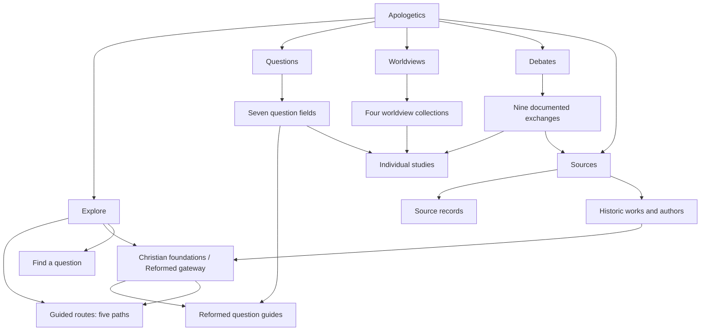
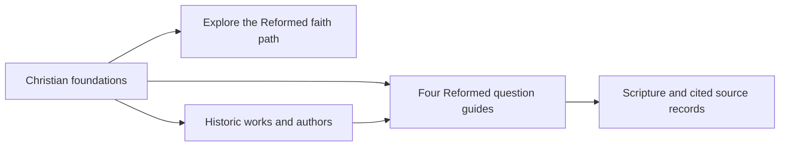

# Apologetics navigation map

Proposed information architecture for review, 2026-10-11. This is a map of the existing collection, not an implementation decision.

## What exists

The current local bar names seven things at the same level: Explore, Questions, Reformed theology, Historic texts, Learning paths, Worldviews, and Debates. They are different kinds of thing. Reformed theology is a subject and tradition; historic texts are a source collection; learning paths are an ordered way through studies. Questions, Worldviews, and Debates are reader destinations. Explore is an entry page.

The authored collection currently has 25 studies in seven topics, five paths, four worldview collections, nine debate studies, and 47 source records. The historic Reformed reading catalogue adds 46 works by 30 authors. Counts are for inventory, not navigation labels; they will change.

## Recommended five-door map

The five bar labels express where a visitor wants to go. The other three current labels become substantial destinations within those doors. This does **not** demote their material or duplicate a study: the same canonical study, work, or path is linked from the relevant context.

| Current destination | Proposed home | Why |
| --- | --- | --- |
| Explore (`/apologetics`) | Explore | An orientation page with clear entries into a question, a guided route, a worldview, or the sources. |
| Questions (`/questions`, `/topics/:id`, `/study/:id`) | Questions | The 25 studies are the core question-led collection. Reformed question guides remain one clearly labeled field. |
| Reformed theology (`/topics/reformed`) | Questions and a Christian foundations gateway in Explore | It is a doctrinal tradition that informs questions. The gateway can connect its four current guides, the Reformed path, confessions, and historic authors without making them one content type. |
| Historic texts (`/texts`) | Sources | The 46 works and 30 authors belong beside the source room, with prominent links back to related questions. |
| Learning paths (`/paths`, `/paths/:id`) | Explore | A route through studies is an onboarding method, not a peer subject. Each question, worldview, and foundations page can recommend its relevant route. |
| Worldviews (`/worldviews`, `/worldviews/:id`) | Worldviews | Four coherent collections warrant their own entrance. Each connects claims, religious texts, studies, and conversation guidance. |
| Debates (`/debates`, `/debates/:id`) | Debates | Nine sourced exchanges warrant their own entrance. Each debate points to its transcript, underlying questions, and sources. |
| Source room (`/sources`) | Sources | A new Sources overview can introduce both the 47 source records and historic reading catalogue before opening either list. |
| Practice (`/practice`) | Contextual action within Questions, Worldviews, and Debates | Three conversation scenarios can be offered after a relevant study or exchange. Keep the old URL working while deciding whether a standalone index remains useful. |
| My study (`/saved`) | Personal utility when it becomes substantial | The present saved/read/notes data lives only in local browser storage. Keep its route and saved data; do not treat it as a primary collection. |

## How the doors should work

**Explore** should answer: "Where do I begin?" Keep the 1 Peter 3:15 anchor. Offer three direct starts: *I have a question*, *I am speaking with someone from another worldview*, and *Guide me through a foundation*. Put the five paths within the guided start. Feature the Christian foundations gateway as an optional, clearly framed route. Avoid reproducing every full catalogue on this page.

**Questions** should answer: "What is the claim, evidence, objection, and limit?" The existing seven topic fields filter the 25 studies. A Reformed field can be introduced as the site's doctrinal perspective, with links to its path and primary historic texts. Study pages continue to open Scripture and citations.

**Worldviews** should answer: "What does this person or tradition actually claim?" Preserve the four collections and their current source-first comparisons. Keep a path to the related question studies and to conversation practice from each collection.

**Debates** should answer: "What was argued, and how can I examine it?" Preserve the nine exchange pages, transcripts, recordings where available, linked studies, and notes about the source record. A relevant practice prompt can sit at the end of an exchange.

**Sources** should answer: "Where did this claim come from?" Introduce two clear shelves: **Cited records** (the current source room, including manuscripts, religious texts, arguments, and transcripts) and **Historic Christian works** (the current texts and authors catalogue). Filters stay within each shelf. The Reformed gateway points here, but Sources should not imply that every source agrees with the site's doctrine.

## A concrete cross-link

The Reformed foundation should have one gateway page or section, not three competing top tabs:

A person can reach that gateway from Explore, the Reformed field in Questions, or the Historic works shelf. The guide, path, and work URLs remain canonical. The gateway explains their different roles: a study argues through a question; a path orders studies; a historic work supplies an inspectable source.

## Alternative: one door for the three uncertain tabs

Use **Explore, Questions, Worldviews, Debates, Deepen**. Deepen would open a page with three explicit sections: **Guided paths** (the five ordered routes), **Christian foundations** (the Reformed guides and their path), and **Read the sources** (the source room plus historic works). This directly gathers Reformed theology, Historic texts, and Learning paths under one parent while retaining their distinct endpoints. It is a credible option if the desired emphasis is *how to go further* after an initial question. Its cost is that "Deepen" gives a new visitor little clue that primary source records and historic authors live there; the Questions and Worldviews pages would need strong links into it.

## Alternative if five doors still feels crowded

Use four bar labels: **Explore, Questions, Worldviews, Debates**. Place **Sources** as a persistent, clearly labeled action next to search and as the cited-source step on every study and debate. This makes the bar simpler, but gives the 47 source records and 46 historic works less prominence. I recommend five doors because the source collection is substantial and accountability to sources is part of the site's promise.

## Implementation boundaries after a design choice

Preserve all existing URLs and browser-local notes. Change the visible bar and active-section mapping first; then make Explore and Sources into useful overview pages. Keep the seven question fields, five path pages, four worldview collections, nine debate pages, source room, and historic catalogue as endpoints. Add cross-links based on actual relationships rather than copying content. Review the navigation at desktop and phone widths, with keyboard access and visible current-section state.

