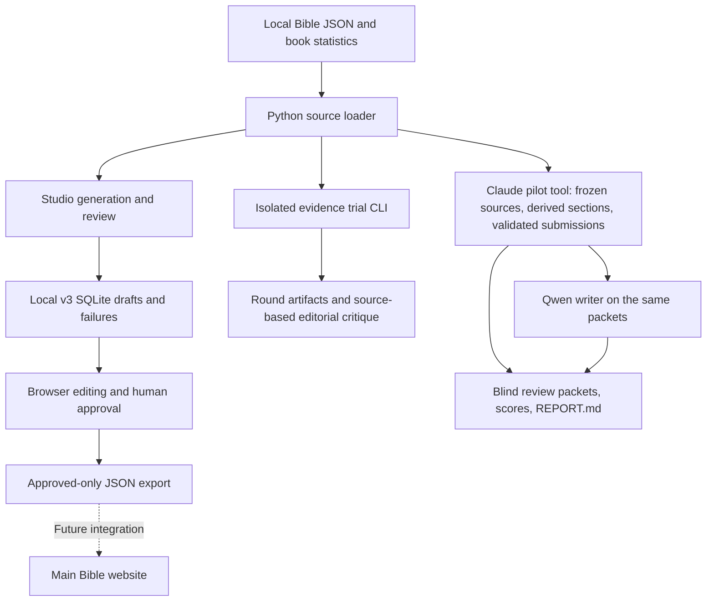

# Architecture and contracts

## Components and data flow



There is no automatic connection from trial artifacts to the studio database, and no implemented publishing pipeline from these exports to the main website.

| Component | File or endpoint | Responsibility |
| --- | --- | --- |
| Studio | `scripts/chapter_summary_studio.py` | Standard-library Python HTTP server, source loader, validation, SQLite, inline HTML/CSS/JavaScript |
| Trial harness | `scripts/chapter_summary_evidence_trial.py` | Sequential isolated experiments; current source reflects round 3 |
| Model runtime | `http://127.0.0.1:11434` | Ollama chat requests to installed local Qwen |
| Studio UI | `http://localhost:8947` | Browse, generate, edit, save, approve, export |
| Main site | `http://localhost:8931` | Existing Bible reader and study website |
| Static preview | `design/chapter-summary-studio/index.html` | Illustrative studio interface without server or inference |

The core Python programs use the standard library. No cloud API, external commentary retrieval, embeddings, or vector search is involved in these summary requests. Historical test helpers used additional tools such as Playwright and psutil; they are not core runtime dependencies.

## Scripture loading

`data/stats.json` supplies book/chapter information. `data/text/{bsb,kjv,web}/{BOOK}/*.json` contains the local source text. Book codes such as `GEN`, `ROM`, and `1CO` are internal identifiers; display labels such as `Gen`, `Ro`, and `1Co` are separately defined in `BOOK_REFS`.

The loader normalizes text runs and preserves verse numbers and Psalm superscriptions while excluding editorial headings. It hashes the resulting source text. Combined verse labels and empty verse text are handled when deriving the set of actual source verses.

The studio provides the full target chapter, neighboring chapters, and the first twelve verses of the book when the target is beyond chapter 2. Duplicate/target context blocks are excluded. Context references are limited to supplied same-book passages. The writing rules distinguish chapter events from contextual connections.

## Reader-facing v3 schema

`FORMAT_VERSION = 3`; `PROMPT_VERSION = chapter-summary-v3-context-summary-outline`.

```json
{
  "title": "A short descriptive title",
  "context": "",
  "context_references": [],
  "summary": "A readable paragraph following the chapter's movement.",
  "outline": [
    {
      "verse_start": 1,
      "verse_end": 2,
      "heading": "A meaningful section",
      "text": "A concise description supported inside this range."
    }
  ],
  "invitation": "Notice a specific feature as you read the chapter."
}
```

This is a schema illustration, not a source-grounded chapter draft. Each nonempty context reference has integer `chapter`, `verse_start`, and `verse_end` fields.

| Field | Code-enforced limits | Writing intent |
| --- | --- | --- |
| Title | 2–16 words | Usually 3–10 descriptive words |
| Context | 0–90 words; 0–8 references; both note and references empty or both present | Usually at most 35 words; omit unnecessary background |
| Summary | 10–240 words | Usually 80–140, shorter for brief chapters |
| Outline | 1–32 entries; ordered, nonoverlapping valid ranges covering every nonempty source verse | Usually 3–7 meaningful sections, genre-sensitive |
| Outline heading/text | 1–16 / 3–80 words | Text usually 10–35 words |
| Invitation | 4–60 words | Concrete observation, not personal application or a sermon |

HTML and selected Markdown markers are rejected. These limits verify structure and locations, not semantic entailment. Covering every verse with range labels does not establish that every important movement was summarized.

## Studio generation

One daemon worker processes a queue sequentially. Existing chapter keys are skipped. Generation uses Ollama `/api/chat`, JSON-schema output, `think=false`, temperature 0.1, `num_ctx=32768`, `num_predict=2400`, and `keep_alive=5m`. It attempts at most three drafts, retaining bounded corrective feedback.

After structural validation, the studio calls its Qwen reviewer with independently scoped source blocks for context and each outline entry, plus full target text for the overall summary. The reviewer uses temperature 0, `think=false`, the same context size, and an 800-token output budget. It reports at most one issue. In this older studio path, a reported issue triggers a retry. A pass is explicitly not human approval, and observed results show that this reviewer is unreliable.

Successful records include the reader fields plus chapter/model/translation identifiers, source and context hashes, timestamps, format/prompt identifiers and hashes, method-source URLs, token counts, attempts, corrections, review metadata, and `status=draft`. Validation failures preserve the last raw output and corrections separately. Ollama/network errors stop the UI batch; chapter-validation failures are recorded and the queue continues.

The studio Pause action sets a flag checked between chapters. It does not instantly cancel an in-flight model request. A server restart preserves database records but not the in-memory job queue or ETA. Startup is idle; no generation auto-resume occurs.

## Evidence trial evolution

| Round | Evidence passed to writer | Writer mode | Outcome |
| --- | --- | --- | --- |
| 1 | Generated atomic claims plus exact-quote checks and retrieved full source verses | Fast, untraced v3 output | Claims could contradict otherwise authentic quotations |
| 2 | Selected verse IDs, with text retrieved by Python; no generated claims | Fast, untraced v3 output | Eliminated quote-copying failures, but selected evidence could miss key endings |
| 3 | Every source verse in each model-proposed section | Reasoning enabled; internal sentence/outline citations | Easier to audit, but meaning errors and section gaps remained |

Rounds 1–3 used a splitter that returned 1–8 start/end pairs. In both blocked chapters (Genesis 5, Psalm 119) the model filled all eight slots and stopped. **Since 2026-10-13 that is replaced by deterministic coverage:**

- **Planner contract** (`PLAN_SCHEMA`, prompt `EXTRACT_STARTS`): `{"section_starts": [1–32 ints], "context": [0–3 {chapter, verse}]}`.
- **`studio.verse_units(scripture)`**: one `(first, last)` unit per source verse entry that has text, in order. A combined label "3-4" is one unit that cannot be split. An entry with empty text, or a number absent from the source (BSB omits 16 verse numbers in 15 New Testament chapters, e.g. Matthew 17:21 and Mark 9:44, 46), belongs to no unit. Unreadable, reversed or out-of-order labels raise.
- **`studio.derive_sections(scripture, starts)`**:
  - Starts must be whole numbers, strictly increasing, and begin at the chapter's first verse.
  - Each start must be the first number of a unit, so a section never starts inside a combined verse, on an empty verse or on an omitted number. The error names nearby valid starts.
  - Each section ends at the last number of the unit just before the next start; the last section ends at the final unit.
  - A post-check raises if any verse is uncovered.
  - Result: every start and end is a real verse with text, and every source verse lies in exactly one range. That is complete input coverage only; it says nothing about whether the summary handles each section well.
- **`trial.validate_plan`**: derives the ranges, then rejects a lumped final section (≥12 verses and more than twice the median of the others, the shape a plan that stopped early leaves), then hydrates every verse entry once (a combined label once, not once per number).
- **Single-pass studio Generate** keeps strict rejection of model start/end gaps. Auto-extending would attach verses to text that never described them. Its error now lists the missing verses.

Data facts behind this (scan of all 1,189 chapters in BSB, KJV and WEB): no combined labels exist today; BSB has no empty verses; WEB has five empty entries (e.g. Luke 17:36).

The current writer returns `summary_sentences`, each containing `text` and `evidence_verses`, and adds `evidence_verses` to outline entries. Python checks that these are valid target verses (and within each outline range), joins the sentence texts into `summary`, strips the extra fields from the reader draft, and saves the audit map separately in `sentence-support.json`.

Trial requests use temperature 0, a 32,768-token context, and at most two attempts per stage. Current extraction budget: 5,000 output tokens with thinking off. Current writer budget: 6,000 with thinking on. Truncated output is rejected. The prior fast-writer budget was 2,600. Each round's manifest records its actual prompts and complete harness source; changing `--round` alone does not recover a historical implementation.

The trial reviewer is advisory and does not rewrite or approve a draft. Every produced draft was subsequently inspected against Scripture by Codex and annotated separately; no generated text was silently repaired for the reported scores.

## Claude pilot tooling (2026-10-13)

- **[chapter_summary_claude_pilot.py](../../scripts/chapter_summary_claude_pilot.py)** makes no model calls. An outside writer submits files and the tool validates them. `prepare` freezes sources (or copies another run's sources and validated packets with `--from-run`), writes `plan-prompt.txt`, and records a manifest and `code-snapshot/`. `plan` and `write` store each raw submission with its SHA-256, validate it (`validate_plan`, then `validate_traced_writer`, plus the length gate when the run enables it), and write `evidence.json` + `write-prompt.txt`, or `draft.json` + `sentence-support.json`. There are at most two attempts per stage, and validated results are never replaced.
- **Writer prompts** are versioned in `WRITER_PROMPTS`. v1 is the unchanged round-3 `trial.WRITE`. v2 appends length/shape guidance and "keep any condition that defines a promise, warning or threat".
- **Length gate** (`summary_word_limit`): 70 words for chapters of 1–5 verses, 150 up to 30 verses, 180 above. It is a rejection with a retry message, not a truncation.
- **[chapter_summary_writer_comparison.py](../../scripts/chapter_summary_writer_comparison.py)** runs the local Qwen writer, with round-3 settings, on a pilot run's validated packets. It uses the run's prompt version and gate and writes `<chapter>/qwen-writer/`.
- **Review tools** (no model calls), all in [tools/](tools/):
  - `build_blind_review.py`: seeded A/B/C packets plus a separate key.
  - `score_blind_review.py`: unblinds and totals by draft set.
  - `build_pilot_report.py`: `claude-pilot/REPORT.md`.
- The reader schema is unchanged. `summary_sentences` and `evidence_verses` exist only in the writer's internal format; the reader draft is the six agreed fields.

## Storage and provenance

Studio SQLite tables are `summaries(key,payload)` and `failures(key,payload)`. A successful save removes the failure for that chapter. Key format is `BOOK:chapter`; separate databases preserve historical formats.

Approved-only export writes `approved-chapter-summaries-v3.json` with schema version, timestamp, and approved records. Export refuses when no records are approved. It writes a local JSON artifact, not a website deployment.

Trial folders contain manifests, source snapshots, stage responses, validation errors when present, evidence packets, drafts when valid, advisory model reviews, timing results, completion metadata, and Codex editorial notes. Round 3 adds sentence support. `verification.json` records file hashes and confirms that the supplied source inputs were unchanged across all three rounds. It is an integrity record, not a semantic accuracy certificate.

## Local API

All endpoints are on the studio's loopback server. Host headers must match `localhost:<port>` or `127.0.0.1:<port>`. POST requests require JSON and the ephemeral `X-Studio-Token` embedded in the loaded page's boot data. Do not copy this token into documentation or automation secrets.

| Method/path | Input or result |
| --- | --- |
| `GET /` | Studio page and boot data |
| `GET /api/state` | Saved records, failures, and in-memory job state |
| `GET /api/models` | Installed non-embedding Qwen model names |
| `GET /api/chapter?code=GEN&chapter=4&translation=bsb` | Normalized source verses, text, hash |
| `POST /api/start` | `code`, integer `chapter`, `scope` (`chapter`, `book`, `all`), optional model/translation; launches inference |
| `POST /api/pause` | Empty JSON object; pause after current chapter |
| `POST /api/save` | Chapter identity, all reader fields, `status` (`draft` or `approved`); existing record required |
| `POST /api/export` | Empty JSON object; write approved-only local export |

POST bodies are limited to 20,000 bytes. Responses use no-store caching, JSON errors, content-type protection, and frame-ancestor denial. This is a local workstation tool, not a hardened remote service.

## Safeguards and their limits

- Loopback binding, allowed Host headers, and a per-launch mutation token limit unintended browser access; do not expose the service publicly.
- Validation prevents malformed records, nonexistent references, overlapping/gapped ranges, and selected formatting problems. It cannot prove faithful paraphrase.
- The studio prevents a second UI job and preserves existing keys. The isolated CLI has no shared cross-process generation lock.
- Archives and separate round folders prevent routine overwrite; the CLI refuses an existing round directory. Existing local data still needs an explicit backup outside Git.
- Manual approval controls exports. An automatic model pass is not approval, and manual edits can leave stale review metadata unless explicitly invalidated.
- ETA is a moving estimate from actual completed work, not a guarantee. Early 90-minute expectations applied to a much shorter output format and do not describe the tested structured/reasoning pipeline.
