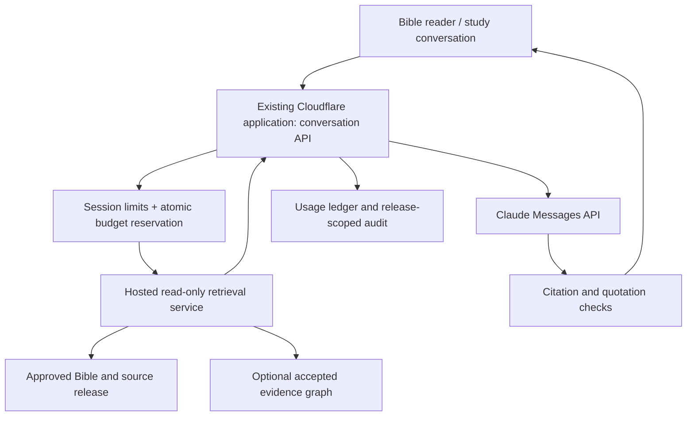

# Claude conversational Bible study — draft proposal

**25 October 2026 · proposed design only.** Owner request: let website visitors ask questions and study Scripture conversationally using approximately $200/month of Claude API credits, with the Bible primary and a deliberately curated class of respected works providing subordinate help.

This document proposes a public consumer of the existing library-knowledge system. It does not authorize deployment, API expenditure, private-source publication, corpus repair, background jobs or graph mining. Implementation tasks should enter the existing [TODO](TODO.md) when selected, rather than form a competing execution backlog.

## Product and editorial position

Offer “Ask about this passage” from the Bible reader and existing chapter summaries, plus an optional standalone study conversation. Summaries are available for every Bible chapter; they are editorial aids, not Scripture or a substitute for retrieving the passage.

Initial capabilities:

- Explain a passage in its chapter/book context.
- Follow a biblical theme through cited passages.
- Compare two passages without hiding apparent tensions.
- Ask follow-up questions and build a short personal/group study outline.
- Consult selected commentaries or confessional sections and inspect their exact sources.
- Compare interpretations with clear attribution when the selected sources actually support the comparison.

Default response: a direct answer, linked Scripture, a short explanation, optional attributed commentary, and one useful follow-up. Source cards distinguish Bible text, subordinate doctrinal standards, commentary and site-authored material. Show “Why this source?” and an actual passage/section destination, with coarse destinations labelled honestly.

The Bible is final authority. Present the site's stated Reformed editorial basis openly. Confessions remain subordinate standards; respected commentators remain fallible. Do not infer agreement from repeated citations, vector similarity or author reputation. Accurately attribute positions outside the editorial tradition when relevant and permitted.

## Fit with the repository

Reuse [DESIGN](DESIGN.md), [ARCHITECTURE](ARCHITECTURE.md), [evidence contract](EVIDENCE-CONTRACT.md), [public-use eligibility](PUBLIC-USE-ELIGIBILITY.md) and [graph plan](../../knowledge/GRAPH-PLAN.md).

Existing owners remain responsible for source bodies, IDs, vectors, sections, evidence, curation and public releases. Extend adapters around:

- `knowledge/library_analytics/`: section/span and reader alignment.
- `knowledge/evidence_collections/`: ranked evidence, context expansion and reproducible captures.
- `knowledge/enrichment/`: accepted typed relationships and provenance.
- Existing catalogue and reader builders: work/edition/contributor identities and destinations.

Latest initiative notes reviewed here report corpus completion needing attention as of 20 October and failed KR-110 retrieval acceptance. Those dated reports establish neither current health nor production readiness. A small independently validated public subset can be evaluated separately; broad corpus/vector release requires fresh verification. Do not restart existing corpus owners or recreate retired KR-130 extraction.

## Source policy: authority and eligibility are separate

Use a versioned, reviewed allowlist at **work/edition/section scope**, never an automatic author-wide trust score.

| Class | Role | Default eligibility |
| --- | --- | --- |
| Scripture | Primary evidence, with edition-specific verse identity | Approved translations with required attribution |
| Subordinate standards | Explain the site's confessional position | Selected approved sections, explicitly labelled |
| Curated exposition | Respected commentaries and theological works | Only reviewed work/edition scopes |
| Context evidence | History, manuscripts, archaeology, opposing positions | Relevant contextual questions; no doctrinal-authority promotion |
| Site editorial | Existing summaries and study guides | Navigation/explanation, labelled as editorial |
| Unreviewed holdings | Broad acquired collection | Excluded from public AI retrieval |

Calvin and selected Henry commentary are possible starting candidates; Westminster is a candidate subordinate standard. Modern works such as Ferguson, Sproul, Kruger or Ligonier material require specific edition, accuracy, permission and scope checks. These names are proposals, not a newly approved source list. Existing source restrictions, including the Josephus placement rule, continue to apply to conversation surfaces.

Each policy record includes existing work/edition IDs, allowed sections, role, tradition, subject scope, exclusions, reviewer/date/reason, text quality, source hash, external-model processing permission, public answer/quotation permission, quotation limits and reader destination eligibility. Unknown permission means excluded. Local possession or public-domain status alone does not establish relevance or editorial approval.

Apply eligibility **before candidate retrieval, context expansion, graph traversal and caching**. Post-filtering alone can lose permitted results or expose private snippets. Prevent restricted neighboring sections and graph nodes from entering results. Preserve all holdings unchanged.

## Runtime architecture

Keep the API key in server secrets. Use the existing Cloudflare backend as the proposed gateway, subject to checking current routing/runtime limits during implementation. Host retrieval on a small managed service with a persistent read-only search snapshot; measure its CPU/RAM/disk needs on the curated subset. A Python service can reuse SQLite FTS5 and existing compatible vector readers. Do not place the complete local SQLite/Lance corpus in Pages assets or require the owner's PC to be running.

Export an immutable public allowlisted subset with manifest, hashes, IDs, permitted text and rights metadata through existing owners. Retain the last good release; switch pointers atomically. Private corpus/vector stores remain local. Reuse compatible approved vectors if export is allowed; otherwise lexical-only is a valid measured starting point. Query embeddings must match the stored model/revision/dimensions and normalization. Claude generation does not replace the embedding model.

Hosting, storage, embeddings and any later speech services have separate costs; Claude credits do not pay those bills.

## Bounded retrieval and agent loop

1. Validate request size, session and selected Bible edition. Resolve explicit Scripture references deterministically and fetch canonical text plus bounded chapter context.
2. Search the eligible subset using references and lexical search; optionally add compatible vector candidates. Fuse ranks, deduplicate editions and diversify independent works.
3. Expand only within verified allowed sections. Return normally 6–10 compact evidence passages inside a total input budget.
4. Ask Claude to answer using this evidence. For genuinely missing context, allow one additional bounded retrieval round.
5. Validate citation IDs, original quotation text and edition-specific Scripture endpoints before final delivery. Unsupported statements must be qualified, removed or answered with a clear evidence limitation.
6. Persist usage and response metadata; return clickable source cards and follow-up actions.

Default one generation call. Maximum three model calls per turn, including any tool-selection/retrieval follow-up or repair; every call consumes the same turn budget. Limit total tool results, graph expansions, input tokens, output tokens and wall time. No open-ended autonomous loop, remote browsing, arbitrary SQL, shell tools or write access.

Read-only tool contracts:

- `get_scripture(edition_id, normalized_range)`
- `search_sources(query, approved_filters, limit)`
- `get_context(evidence_id, bounded_window)`
- Later: `get_connections(entity_id, allowed_relations, max_hops)`

Server validates all arguments and derives source eligibility from trusted policy, not model-supplied filters. Retrieval records contain release, work/edition/document/section/span IDs, literal text/hash, locator kind, attribution, editorial role, public URL and evidence-path provenance.

For graph-assisted retrieval, start with one hop and at most 20 additional candidates over accepted citation, containment and bibliographic edges. Preserve relation meanings. Shared references do not establish exposition, influence or doctrinal agreement. Benchmark against ordinary RAG before enabling graph expansion. Avoid corpus-wide model-generated graph/community summaries for launch.

## Claude integration and answer contract

Use the server-side Messages API with an explicitly configured supported model ID, token limit, timeout and streaming. Pin and evaluate model changes. Sonnet is the initial quality baseline; evaluate Haiku for simpler requests before routing public doctrinal answers to it.

Supply a stable editorial instruction, selected passage/edition, bounded recent conversation, and separately delimited source blocks with opaque citation IDs. Source and user text are untrusted instructions: they cannot alter tool permissions, source policy or budgets.

Return structured content with answer sections and citation IDs, then render safe Markdown and server-generated links. Native citation features may assist after format compatibility is verified; the application's evidence validation remains necessary. Cite substantive interpretive claims; distinguish application and inference from direct quotation. Mechanical validation proves identity and text, not theological entailment.

Keep recent turns inside a fixed history budget, plus a compact topic/reference summary where needed. Any summarization is metered. Earlier AI responses are conversational context, not new source evidence. Re-retrieve for follow-up claims.

Streaming can show retrieval status and provisional prose, but do not render unchecked quotes/links as verified citations. On truncation, cancellation or upstream failure, mark the answer incomplete and settle observed costs.

## Budget and capacity

API credits are the owner's stated funding premise. Official documentation checked 25 October 2026 describes $200 monthly API credit for Max 20x after linking an eligible Console organization. Confirm the actual credited balance and expiry in that organization before launch. Credits can be shared by other keys/workspaces and refresh on the subscription cycle; provider monthly spend caps reset on a different calendar schedule. Allocate the site's budget from confirmed remaining credits.

Sources: [subscriber API credits](https://platform.claude.com/docs/en/about-claude/api-credits-for-subscribers), [official pricing](https://platform.claude.com/docs/en/about-claude/pricing). Rates can change; runtime accounting must use a versioned price table.

For planning, the checked standard Sonnet 5.5 rates are $2/million input tokens and $10/million output tokens. Cache categories have separate prices. Below assumes uncached standard requests and excludes hosting, tool fees and speech:

| Ten-turn text session | Total input across all calls | Total output | Model cost | Sessions within $160 visitor allocation |
| --- | ---: | ---: | ---: | ---: |
| Compact | 40,000 | 5,000 | $0.13 | 1,230 |
| Standard | 80,000 | 8,000 | $0.24 | 666 |
| Research-heavy | 200,000 | 15,000 | $0.55 | 290 |

Totals include repeated history, retrieved evidence and tool-result prompts. Any extra model calls must fit these totals or increase the estimate. Ten minutes is not a billing unit: these are ten-turn scenarios, not measured guarantees. At the standard estimate, 50 sessions cost $12 and 100 cost $24. A hundred users having many sessions is a different workload. Actual capacity must come from a pilot measuring tokens, retries and answer quality. Speech-to-text/text-to-speech would require its own design and budget.

Propose $160 visitor allowance, $20 evaluation/maintenance and $20 contingency per credit cycle. Initial ordinary turn ceiling: 12,000 total input and 1,200 total output tokens across all calls (about $0.036 at these rates); session ceiling $0.60 and 15 turns. Longer research turns need a separately bounded mode. Set provisional session/day limits and adjust them using measured demand.

Before **each** provider call, atomically reserve its conservative maximum charge against global, session and principal balances. Count system/tool overhead, cache creation/reads, output/thinking where applicable and retries. Use a consistent central transaction/serialized budget owner; browser storage and eventually consistent counters cannot enforce a shared cap.

Record actual provider usage, model, request ID, rate version and charge; release unused reservation only after settlement. For unknown outcomes retain conservative reservation until reconciliation. Application idempotency prevents duplicate user submissions; do not assume it makes an ambiguous provider retry free. Reconcile all organization consumption and expiry; stop if remaining credit cannot be established.

Use provider workspace/organization spend limits as additional containment, disable automatic reload for the credits-only deployment, and keep the app below the available balance. Never promise an exact zero-overspend guarantee solely from a delayed provider usage dashboard. Do not configure billing or spend money while drafting.

When the allowance is exhausted, offer ordinary Bible reading, existing chapter summaries and source search with a clear renewal message. Do not silently charge a card or switch to unapproved models.

## Sessions, privacy and abuse controls

Start with an invitation pilot of 50–100 people. Keep ordinary website reading account-free. Signed anonymous sessions plus short-lived rate limits and a challenge can support public access later, but anonymous identity limits are bypassable; the global dollar cap is the firm protection. One concurrent generation per session, request/body limits, a small global concurrency queue and per-IP abuse signals reduce draining. IP alone is not a fair identity for shared networks.

Conversations can contain personal spiritual concerns. Explain that messages and selected evidence go to Anthropic. Proposed default: browser-held conversation history with clear reset/export, no server transcript retention; short-lived session and billing metadata with a documented retention period. Avoid raw prompts, source bodies or full IP addresses in routine logs. Any opt-in quality samples require explicit notice. Do not claim that the provider retains nothing; confirm current API data terms during implementation.

## Evaluation, rollout and review

Use a frozen 60-question set: 15 passage explanations, 10 cross-passage themes, 10 doctrinal questions, 10 follow-ups, 5 disputed-attribution cases, 5 insufficient-evidence cases and 5 prompt-injection/private-source cases. Include verse-numbering differences, quotations of opponents, duplicated editions and misleading high-similarity material.

Before inviting visitors require:

- All delivered citation IDs resolve; Scripture endpoints and literal quotations reproduce the approved source edition.
- Zero private/disallowed passages in answers, tools, logs or cross-user caches.
- Human review of doctrinal answers and source roles; model grading alone does not satisfy theological review.
- At least 90% of reviewed substantive claims supported by the cited evidence, with no severe fabricated quotation or misattribution; report denominators and failure classes.
- Adversarial concurrent requests cannot exceed reserved app allowance; exercise cancellation, unknown outcomes, retries and credit-cycle boundaries.
- Measure useful-answer rate, abstentions, cost/session, p50/p95 first-token and completed-answer latency. Set realistic operational targets from the pilot.
- Compare lexical/reference RAG, hybrid RAG and optional graph expansion on held-out cases. Enable added complexity only for demonstrated benefit.

Proposed sequence: review this proposal and source-selection principles; audit current endpoints and select a small eligible release; build a disabled-by-default vertical slice with mocked provider usage; run bounded paid evaluation after implementation authorization; invite the pilot; then consider public rollout. Existing corpus repair and broader analytics stay under their current owners.

Open owner decisions: first approved works/editions; how prominently to present the confessional stance in chat; invitation versus anonymous launch; which optional study tasks matter most; whether voice is a later requirement. Defaults in this proposal permit design review without resolving these questions now.
