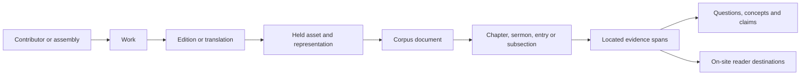
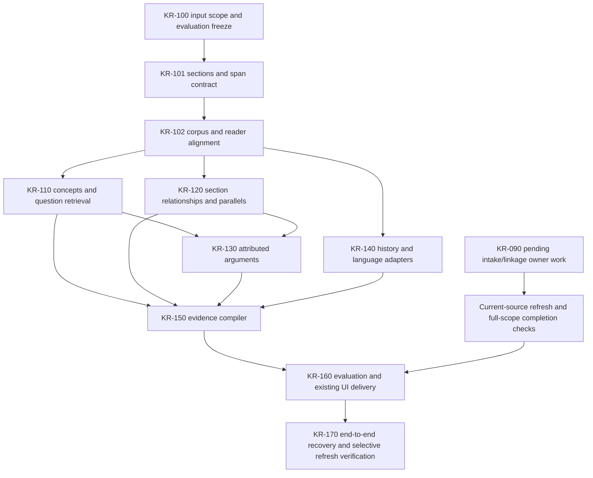

# Connected research system design

**Design version 1 · execution status updated 14 October 2026.** [Home](README.md) · [Backlog](TODO.md) · [Handoff](HANDOFF.md) · [Current assessment](REVIEW-2026-10-13.md).

## 1. Outcome and scope

Build a procedural system that connects held source sections to Scripture, concepts, questions, attributed arguments, historical evidence and useful reader destinations. Save the resulting research once; reuse it for passage companions, author comparisons, questions, sermons, historical dossiers, teaching and compact discovery. Website visitors consume prepared releases without contacting the owner's PC.

The latest bulk work provides normalization, literal references, positional roles, vocabulary and candidate reuse. This design adds deeper connections. Document counts, token counts and successful jobs describe throughput. Useful questions answered, attribution accuracy, source locations and independent-work diversity describe capability.

The first system's section/span backbone and chunk/reader alignment are population-complete for their supported snapshots: [section receipt](../../knowledge/library_analytics/SECTIONS-RESULT.md) and [alignment receipt](../../knowledge/library_analytics/ALIGNMENT-RESULT.md). The remaining five systems are proposed. Existing Ephesians and retrieval packages are bounded examples to reuse. Full-current-library and interpretive capability require their respective checks.

## 2. Reuse existing owners

| Existing owner | Reuse | Boundary |
| --- | --- | --- |
| `knowledge/library_analytics/` | Input adapters, durable jobs, lexical/reference results, dimensions and release verification | New processors extend the package; no second corpus or ingestion coordinator |
| `knowledge/evidence_collections/` | Captures, context expansion, ranked retrieval, reproducible packaging and dependency invalidation | Preserve earlier frozen questions, judgments and captures |
| `knowledge/enrichment/` | Typed graph assertions, evidence and release/quality policy | New facts enter through this owner; do not bypass deferred rule classes |
| `knowledge/research_foundation/` | Historical resource IDs, structured claims, sources and citation contracts | Retain source namespaces, competing interpretations and distinct date roles |
| Existing corpus/vector pipeline | Bodies, chunks, FTS5, saved vectors and their model/version identities | Read-only analytical input; preserve original vectors and single completion owner |
| Catalogue, reader and website builders | Works, editions, contributors, routes and public output contracts | Source corrections and delivery go through their owners; no replacement website |

Private connected-research state exists under `KnowledgeBase/library-knowledge/connected-research/`, including the completed section store and `alignment/` derived store. Extend existing stores when their grain and ownership fit. A separate derived database is justified only by measured isolation/query needs and must reference existing IDs rather than copy millions of bodies. The graph is a projection of supported relationships, not another authority for source text.

## 3. Identity and grain

Each arrow is an explicit relationship with evidence, not an assumption of one-to-one correspondence. A work can have multiple editions and documents; an asset can contain many reference entries; one section can span several chunks. Unknown identities remain unassigned. Assemblies, editors, translators and speakers retain separate roles.

Sections are the primary comparison unit. Source spans are the evidence unit. Works are the principal independence unit for source diversity. Chunks are storage/retrieval units, not automatic arguments. Keep document-level fallback results visibly coarser than located section results.

IDs use existing namespaces where possible. New section IDs depend on a source representation identity plus native structural key or segmentation rule/boundary identity. Preserve historical versions. A changed boundary invalidates dependent section evidence; remapping requires recorded alignment. Do not assume chunk IDs survive a title change: the existing writer includes title, body and locator in their identity.

## 4. Shared proposed data contract

These are logical tables/records. KR-101/102 now implement the section, span, chunk-link and destination responsibilities; their operator contracts name the actual schemas. Remaining records are proposed. Reuse equivalent existing fields and avoid storing body copies when source locations suffice.

| Record | Grain and essential fields |
| --- | --- |
| `research_runs` | Run, input generations/build, eligible population, processor/config/model versions, status, counts and receipt |
| `sections` | Section ID/version, document, work/edition when known, parent, section kind, native key, heading, boundary method and state |
| `section_segments` | Section → ordered source segments; coordinate type, block/chunk/native locator, `[start,end)`, text hash and source asset identity |
| `section_chunk_links` | Section → existing chunk IDs with overlap and snapshot; crossing boundaries stays explicit |
| `section_destinations` | Exact span/page destination, containing-section/book destination or unresolved state; reader/build proof and alignment basis |
| `concept_occurrences` | Section/span → concept sense, literal evidence, language, rule/model version and candidate/review state |
| `question_evidence` | Question → section/span, channel/rank, author constraints, evidence role, inclusion/exclusion reason and source independence group |
| `section_relations` | Typed endpoints, relation, direction, basis, source witnesses or calculated features, version and state |
| `claims` / `argument_links` | Located statement, asserting/quoted speaker, attribution basis, claim type, premise/objection/reply/qualification links and unresolved alternatives |
| `historical_links` / `language_alignments` | Explicit existing entities, date roles/ranges or source/translation spans, supporting evidence, uncertainty and method |
| `evidence_dependencies` | Output → source/run/rule/review dependencies used for invalidation and rebuild |
| `evaluation_cases` / `evaluation_results` | Frozen questions/windows, split, gold or review evidence, reviewer type, metrics, failure classes and run |
| `research_releases` | Schema, scope, coverage/deferrals, files/hashes, evaluation receipt and promotion state |

Text coordinates must name their representation. Extraction-cache offsets, original XML paths, corpus chunk offsets, printed labels, reader pages and transcript timestamps are not interchangeable. Offset transformations require an alignment map. Store multiple segments for a span that crosses blocks; verify literal text against exact source hashes. Approximate alignment cannot silently become an exact destination.

## 5. System A: section and location backbone

**Implemented modules:** `section_catalog.py`, `section_alignment.py` in the analytics package, integrated with existing input adapters. The supported KR-102 release has 1,161,753 section statuses, 18,893,464 chunk pieces and 908,211 reader pieces; 360 independent population witnesses passed. Exact reader coordinates coexist with containing-book URLs because the existing reader has no page selector. Remaining unsupported adapters and human boundary/semantic evaluation are explicit in the execution receipts.

Recover native structure first: TCP/CCEL divisions and headings, SWORD commentary entries, EPUB spine sections, source sermon boundaries and structured reference entries. Retain PDF page structure without treating every page as a semantic section. Plain-text headings and boundary inference produce explicitly labelled candidates. Front matter, footnotes, indexes, quotation blocks and primary prose require separate segment roles where evidence supports them.

Align source sections to corpus chunks and existing readers using same-representation text proof and versioned normalization maps. Reuse shared-XML entry proofs and Ephesians selectors. Cross-edition relationships require their own alignment; matching titles or belonging to one work does not establish passage equality. A containing-book route is useful but remains weaker than a verified section/page destination.

An independent bounded sample checks boundaries and alignment across source types before scale. Then process all supported documents in the selected population, with every unsupported/ambiguous case recorded. Acceptance includes correct containment, unique/resolved identities where supported, round-trip source-span checks, changed-boundary invalidation and meaningful section queries. Report exact versus approximate versus containing-book destinations separately.

## 6. System B: concepts and questions

**Proposed module:** `concept_index.py`, extending existing topic IDs, term rules and retrieval tools.

Use multiple evidence channels: exact vocabulary, language-scoped aliases, contextual rules, literal references, explicit section headings, and existing vector similarity. Topic senses distinguish uses of terms such as justification, law, covenant and assurance. Store multiple concepts per section and preserve unmatched or ambiguous senses. Term frequencies remain descriptive features.

Existing vectors can supply section representations and candidate neighbors. Record vector model, dimensions, table version, contributing chunks, aggregation/dedup method and coverage. A centroid is an approximate retrieval feature; it is not a summary or doctrinal position. Exclude invalid/zero vectors and report sections lacking vector coverage. Generate candidates with bounded nearest-neighbor retrieval or indexed anchors, never an all-pairs chunk matrix.

Question retrieval combines channels through measured ranking, respects requested author/work/language constraints and expands neighboring context within verified section boundaries. Retain individual channel scores/ranks rather than pretending lexical and cosine scores share a scale. New query embeddings, when needed, use the existing model owner within an explicit workload; this design launches no encoder.

Acceptance compares useful located evidence with lexical/reference baselines on fresh reserved questions. Report author-specific failures, primary-prose versus front-matter mistakes, context quality, coverage and independent works surfaced. Existing 20-question pilot results remain historical diagnostics and are not a reusable untouched test set for tuning.

## 7. System C: relationships and textual parallels

**Proposed module:** `relationship_miner.py`, reusing literal references, full counts and reuse candidates.

Calculate section-level co-citation, shared-reference patterns and semantic neighbors. Downweight ubiquitous references and normalize for section length and source representation. Preserve ranges and citation roles. Bible texts, indexes and imported associations do not receive the same interpretation as an author's prose citation.

Improve candidate reuse into aligned exact/approximate span pairs with context. Distinguish repeated boilerplate, Scripture quotations, duplicate representations, editions of a work and candidate parallels across works. Measure recall on known located examples; the current 64-signature-per-document cap has no established exhaustive recall. Candidate generation remains bounded and reports skipped high-frequency postings.

Similarity does not prove agreement or influence. Historical dependence requires source attribution or additional supported evidence; chronology is a necessary constraint where relevant, not sufficient proof. Keep calculated relations separately typed from located source assertions. Acceptance requires reproducible witnesses, clear independence groups and precision/recall by relationship class.

## 8. System D: attributed claims and arguments

**Proposed module:** `argument_extract.py`, building on existing capture and graph evidence contracts.

Identify author statements, quoted speakers, reported positions, objections, replies, definitions, applications and qualifications. Represent the actual statement and its scope; link premises and evidence without declaring theological truth from connectivity. Distinguish the source author's conclusion from our editorial assessment. An uncertain speaker remains unresolved rather than inheriting the book's author automatically.

Run structural/contextual rules first. Apply selective model-assisted analysis to eligible, useful sections with an explicit budget, recorded model/prompt versions and retained source evidence. Treat outputs as model-extracted candidates until the applicable evaluation/review condition is met. Do not send every chunk through generation. A comparison can include accepted attributed claims alongside separately labelled unresolved candidates.

Acceptance uses fresh cases containing objections, negation, quotations and qualifications. Verify attribution, claim scope, missing premises and contradictory readings. Model review is recorded as model review; it does not acquire a human-review label. Public doctrinal interpretation follows the site's existing editorial process. Preserve source-designated context-only status and the owner's Catholic-material cautions.

## 9. System E: history and languages

**Proposed adapters:** `historical_links.py`, `language_alignment.py`; integrate with the existing research foundation rather than inventing replacement person/place/source IDs.

Link source passages to held archaeology/history records, people, places, events and finds using exact IDs or supported mention resolution. Preserve competing interpretations and the difference between an artifact observation and an argument about it. Store composition, sermon delivery, edition, translation, discovery and event dates separately, with ranges and unknown values. The current high rate of missing captured dates prevents treating a chronological plot as complete.

Use language-specific terminology and source numbering rules. Reuse lemma/morphology annotations where actually present; Strong's identifiers alone do not constitute complete morphology. Distinguish English modernizations, Latin/Greek originals and translations. Alignment stores explicit span pairs, method and review state; semantic similarity does not certify translation equivalence.

Choose supported initial source/language strata through actual held coverage, then widen passing adapters. Report unsupported strata. Josephus may be analysed privately under existing source contracts, but public Josephus quotations, retellings and explicitly dependent claims remain confined to Scholars under current editorial rules.

## 10. System F: offline evidence compiler

**Proposed module:** `evidence_compiler.py`, extending the existing reproducible collection assembler.

Compile passage dossiers, narrower-question collections, author comparisons, sermon segments, history dossiers and discovery recommendations from shared records. Each output retains selected evidence, attribution, qualifiers, related source sections, dependency fingerprints, unsupported coverage and applicable destination/use rules. A prepared answer and a list of candidate sections are different products and must be labelled accordingly.

The compiler selects diverse independent works without counting duplicate editions or copied quotations as extra witnesses. It can produce several projections from one evidence set: data tables, a passage sidebar, a comparison, a lesson packet and search descriptions. Editorial changes invalidate dependent outputs; restore/replay must be deterministic for unchanged inputs.

Private completeness and public eligibility are separate. Public projections use allowlisted fields and existing source/editorial decisions; no private paths or restricted bodies leak into metadata. Hosted artifacts contain useful explanations and source locations so visitor requests need no local vector service. Preserve the existing browser meaning pack until a measured replacement is ready. Local and browser embeddings are different spaces; re-encode selected permitted descriptions with the browser model rather than truncate local vectors.

## 11. Evaluation and completion

KR-100 proposes 120 new questions across six families: passage exposition, author comparison, practical sermons, quotations/parallels, history, and multilingual correspondence. Use 12 development and eight reserved questions per family: 72 development / 48 reserved. If a family lacks supported source coverage, keep its shortage explicit rather than substitute easier questions. These counts are a proposed first benchmark, not completed evaluation.

Freeze expected evidence and assessment criteria before ranking/interpretation tuning. Hard negatives include opponent quotations, similar terminology with different positions, duplicate editions, front matter, uncertain names, numbering mismatches and absent evidence. Record reviewer type and do not report sampled/model judgments as corpus-wide precision.

| Capability | Measure |
| --- | --- |
| Location backbone | Supported population, boundary accuracy, literal-span resolution, exact/approximate/containing routes and unexplained misses |
| Retrieval | Useful top-five evidence, reciprocal rank, author constraint accuracy, independent works and context adequacy against fixed baselines |
| Attribution | Speaker/endorsement errors, retained qualifications, scope accuracy and unresolved cases |
| Relationships | Located witness precision, recall on known examples, duplicate-witness inflation and skipped computation |
| History/languages | Supported strata, correct date roles, alignment quality and retained competing interpretations |
| Delivery | Accurate on-site destinations, PC-independent operation, permitted exports, size/memory/latency and stale-output removal |
| Operation | Throughput, peak memory, disk growth, interrupted/resumed equivalence and affected-descendant refresh cost |

Set numerical release targets in KR-100 before testing, using source classes and desired product risks; do not invent a success percentage after observing results. Every published exact locator must resolve against its recorded representation. Systematic attribution or edition-remapping errors block the affected capability even if an average score passes.

Task states are proposed, implementing, calibrated, population-complete, evaluated, owner-applied and delivered. A named private snapshot can be population-complete while later acquisitions remain pending. Broad interpretive or whole-library claims require their own relevant checks; one passing job or embedding-progress counter does not establish them.

## 12. Execution, refresh and dependencies

The compiler can deliver clearly bounded discovery/location products before every argument or language adapter is complete. Missing systems remain explicit, not replaced with fabricated summaries. Source-owner intake work can be coordinated alongside snapshot-based processor development; it does not prohibit independent CPU work. Vector-wide releases require recorded vector/build parity for their selected scope. Existing graph gates apply to graph-owner publication, not automatically to every lexical table.

Use the existing job/lease infrastructure and bounded transactions. Job fingerprints include source representation, section boundaries, processor/rule/config/model versions and selected input generation. Output facts and job checkpoints commit together. Retain last good releases after failure. A live source swap, stale dependency or partial vector coverage prevents silently promoting a supposedly complete result.

The [future-additions protocol](FUTURE-ADDITIONS-PROTOCOL.md) specifies recurring source-delta classification, narrow dependency fingerprints, cross-generation reuse, changed/removed membership, population-dependent ranking updates, compatible release sets and consistent backup/restore. Existing same-generation resume and bounded assembler invalidation are implemented; a universal cross-generation planner and backup restoration are not proved. Every KR-110–150 processor must implement the required mechanisms now, with end-to-end verification in KR-170. Saved context and the immediate next task are in [NEW-CHAT-CONTEXT.md](NEW-CHAT-CONTEXT.md).

One coordinator owns each output store. Prefer one low-priority worker until measured CPU, memory and disk budgets justify more. Record long-running job command, PID plus creation identity, progress path, counters and resume behavior in the handoff. No scheduler, service, ingestion restart or GPU process is installed by this design. Existing watchdog repair remains a separately identified ownership task.

## 13. First concrete delivery

KR-100/101 and KR-102 have delivered the supported section/span contract, source adapters, durable jobs and source-to-chunk/reader queries. Their receipts preserve input generations, denominators and deferrals. These completed data releases now supply the next processors.

KR-110 now supplies a populated private lexical/reference candidate index; its reserved retrieval gate failed (see [results](../../knowledge/library_analytics/CONCEPTS-RESULT.md)). Do not treat candidate retrieval as an accepted answer or attribution capability. KR-120 CPU relationship candidates are now populated and evaluated ([results](../../knowledge/library_analytics/RELATIONSHIPS-RESULT.md)); low useful wording precision, repeated works and inherited reference-mapping errors remain unresolved. Semantic neighbors and interpreted-population acceptance are not delivered. KR-130 requires new authorization. Develop the evidence compiler as soon as these inputs can support a real dossier. Argument and historical/language passes extend the same contracts. The acceptance example comparing Gill, Owen and Aquinas remains a target; the system must report thin holdings or unresolved attribution where those editions do not support the requested comparison.
