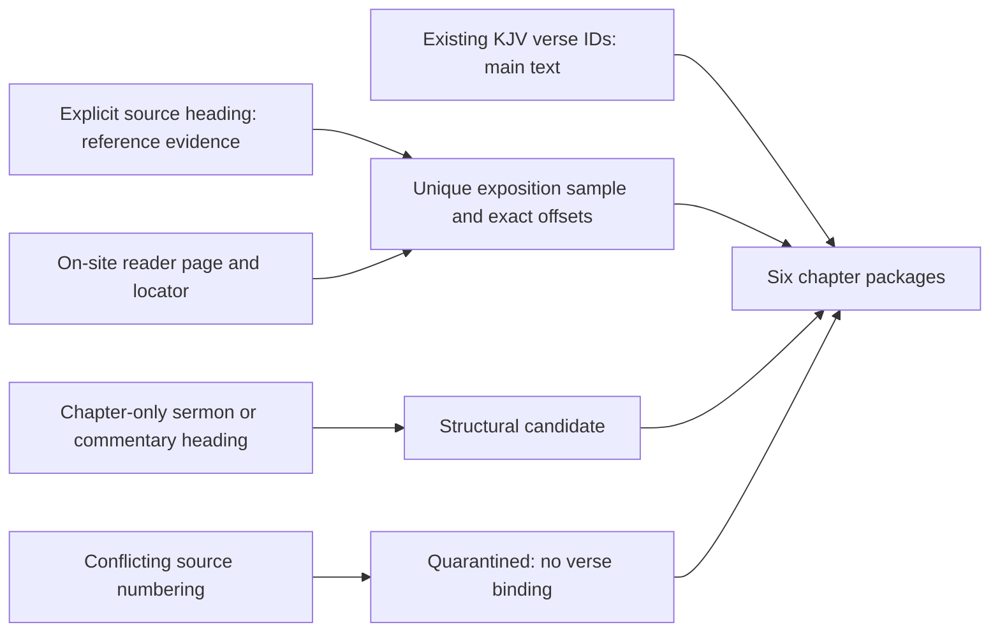

# Ephesians chapter and section connections — LK-202

**Completed 12 October 2026.** Six private chapter packages now connect the existing Ephesians verse IDs to held source sections. The output contains **180 located exposition samples**, **54 chapter-level structural candidates**, and **one quarantined reference conflict**. All 155 verse IDs fall within at least one located section; this is section linkage, not a claim that every verse has a complete or doctrinally approved explanation.

## Delivered coverage

| Chapter | Located samples | Verse IDs linked to located sections | With located on-site samples | Chapter candidates | Reference conflicts |
| --- | ---: | ---: | ---: | ---: | ---: |
| 1 | 22 | 23 / 23 | 22 / 23 | 9 | 1 |
| 2 | 26 | 22 / 22 | 22 / 22 | 8 | 0 |
| 3 | 23 | 21 / 21 | 21 / 21 | 7 | 0 |
| 4 | 41 | 32 / 32 | 32 / 32 | 13 | 0 |
| 5 | 39 | 33 / 33 | 33 / 33 | 10 | 0 |
| 6 | 29 | 24 / 24 | 24 / 24 | 7 | 0 |
| **Total** | **180** | **155 / 155** | **154 / 155** | **54** | **1** |

- **Fergusson:** 146 explicit verse-and-explication sections inspected; 145 have unique gap-free prose samples anchored to corpus offsets and existing reader locations. One reference conflict is withheld.
- **Calvin commentary:** 35 reference-titled sections have uniquely located commentary samples, taken from commentary elements rather than their Scripture-quotation tables. These exact-edition texts remain catalogue-only on the site.
- **Calvin sermons:** all 48 sermons retain their explicit chapter headings. Their verse ranges and local speaker positions remain uncurated; chapter candidates do not count as verse-level located coverage. Arthur Golding's translator credit is retained from the held title.
- **Hodge:** all six chapter divisions remain structural candidates pending passage-level review.

Calvin's commentary and sermons remain separate works by one author. No editions or authors were merged. William Pringle is now explicitly credited in the new Calvin commentary captures, supported by the held XML's `DC.Creator` translator field. Existing corpus metadata and earlier captures were not edited.

## What a connection means

Main Bible text uses existing `verse:kjv:EPH:<chapter>:<verse>` IDs. Scripture quoted in a source heading supplies explicit reference evidence; it is not counted as author exposition. Located exposition requires a prose sample from the corresponding explication/commentary element, a unique match in the correct corpus document and exact Unicode offsets. Its preceding and following corpus context are retained by the existing capture contract. Semantic candidates were not generated, and incidental citations were not promoted into exposition links.

Reviews are **AI-assisted and limited to source location and reference alignment**. The captures deliberately retain unresolved local speaker/endorsement status: a short locating excerpt cannot establish whether a full argument reports, rejects or endorses another position. They do not authorize a doctrinal summary, erase objections, or establish independent human approval. Claim-specific review remains necessary.

## The source conflict and transcription limits

Fergusson's fifth section in chapter 1 prints **“Vers. 5”** above wording corresponding to **Ephesians 1:6**. The original heading is preserved. That connection has no bound verse IDs and no approved excerpt; `Ephesians 1:6` is recorded only as a suggested correction pending review. The separate Calvin section supplies a private located connection for that verse, without silently repairing Fergusson or substituting an outside-site reading link.

The 40 encoded gaps recorded in Fergusson's Ephesians text remain relevant. Samples use intact text before a gap; no gap is removed to join surrounding words. Per-section gap counts and exact XML selectors are saved. A clean locating sample does not certify the rest of its section. Source spelling, repeated partial-verse headings, translator wording and surrounding context remain intact.

All 145 selected Fergusson samples align to the existing on-site reader. Routes remain whole-work routes with separate zero-based page indices and locators; no unsupported fragment or page-query URL is invented. The missing on-site located verse is **1:6**. Calvin's 35 private comparison excerpts have no replacement external reading destination.

## Reproducibility and verification

[connections.py](../../knowledge/evidence_collections/connections.py) reuses the LK-103 capture/schema validation and LK-107 dependency, sealing and private-output helpers. Original sources, capture implementations, source assertions, selected corpus rows, context and reader bundles are fingerprinted. Each chapter separately fingerprints its main Bible rows. Changed inputs mark packages stale; changed outputs cannot overwrite a prior private generation.

- **110 tests passed**, including whitespace-to-original offsets, ambiguous matches, gap boundaries, malformed reference labels, spaced CCEL headings, chapter-only sermon handling, immutable writes and changed main Bible text.
- All **235 XML selectors** resolve uniquely to their recorded elements; all **180 captures** validate against live read-only corpus data and retained context.
- All **145 on-site samples** match reader blocks; all **35 Pringle credits** remain in the new capture records.
- An unchanged rebuild preserves bytes and file modification times; an independent build produces identical objects and manifest.
- **32 earlier pilot artifacts** remain unchanged. No intake, vector, model, reference-index, graph or public-site writes occur.

Private outputs: `KnowledgeBase/library-knowledge/ephesians-connections-20261012/`.

| Path | Purpose |
| --- | --- |
| `spec.json` | Four explicit source hashes and source-bound translator assertions |
| `release-final/manifest.json` | Authoritative six-chapter index and reverse dependencies |
| `release-final/objects/*.json` | Captures, connections, source/reader proofs, coverage and dependencies |
| `verification.json` | Freshness results for all six packages |
| `acceptance.json` | Measured counts, source checks, regression and reproducibility results |
| `pipeline-before.json`, `pipeline-after.json` | Observations of the preserved pipeline |

Development/candidate directories and `reproducibility-copy/` are retained checks, not additional holdings or published products. Use `release-final/`.

At **07:36 EDT on 12 October**, the original embedding worker, loaded encoder, intake owner and graph monitor were verified alive. Embedding had reached **7,876,709 / 8,458,873**, advancing by **8,064** during the observed preparation. Their processes and configuration were preserved; final corpus/graph completion remains under the existing coordinator.

## Remaining gates and next step

The preparation acceptance for LK-202 is complete. **54 candidates** still need passage/voice review, **one source conflict** needs explicit resolution, and **one verse lacks a located on-site sample**. The new sources still require their own canonical crosswalk and output-specific public-use decisions; earlier three-source eligibility reviews do not transfer automatically. The **17/20 retrieval result remains below the proposed 18/20 gate**. No generated answers, website connections or public exports were published.

**Next is LK-203:** prepare the proposed topic collections with narrow questions, existing topic IDs, useful distinct works and explicit evidence gaps. Reuse these chapter packages where relevant; do not fill numerical targets with duplicate or unsupported material. Publication, answer review and site integration remain later tasks.
