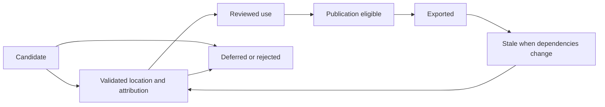

# Evidence collection contract

[Home](README.md) · [Architecture](ARCHITECTURE.md)

LK-103 now implements the private version 1 contract: [implementation and commands](../../knowledge/evidence_collections/README.md), [JSON Schema](../../knowledge/evidence_collections/collection.schema.json), and [real sample results](EVIDENCE-PILOT.md). The logical contract below also describes later review/publication states; v1 supports private drafts and explicit dependency verification, not public export or automatic downstream refresh.

| Field group | Required information |
| --- | --- |
| Identity | Stable collection ID, type, title, question/topic/reference IDs, language, audience and scope |
| Inputs | Corpus build, catalogue version, vector model/revision where used, graph run, source hashes and extraction versions |
| Evidence items | Source/work/edition/asset IDs, chunk IDs, exact available locator, text hash, relevant context and public reader target where available |
| Attribution | Actual speaker/author, quoted opponent if present, translator/editor, work and edition dates with uncertainty |
| Basis | Explicit reference, literal quotation, rule candidate, semantic candidate, derived association or reviewed interpretation |
| Interpretation | Attributed claim, qualification, objection/reply and relation to the question; absent when unsupported |
| Review | State, reviewer identity/type, date, decision, uncertainty and correction history; model review distinct from human review |
| Publication | Separate permissions for metadata, excerpt, full text, translation and derived editorial output; credits and source URL |
| Dependencies | Contributing evidence IDs/hashes, build configuration and downstream products |
| Coverage | Eligible/processed/deferred works, languages, duplicate handling, failures and limits |

## State transitions

These are derived-output review states. They do not introduce `evidenceOnly` intake holds or block authorized private embedding.

## Evidence rules

- A Bible quotation, an author's interpretation and the site's editorial conclusion remain distinguishable.
- Semantic similarity is candidate evidence only. A citation is not automatically exposition, agreement or endorsement.
- Preserve disagreement, quoted opposition and distinctions between author, editor, translator and institution.
- Keep work, edition and asset separate; count independent works when measuring breadth.
- Use the actual source locator. A transcription segment is not a printed page; do not invent timestamps or pagination.
- Historical influence requires evidence beyond similarity and chronological possibility. Unknown dates remain unknown; distinguish composition, delivery, edition and translation dates.
- A missing claim in the selected corpus is not proof an author denied it. Frequency is not consensus or truth.
- Link reading to an available permitted on-site text. External source links belong in provenance; unavailable local reading must be clearly identified rather than silently outsourced.
- Lawfully held material stays eligible for authorized private analysis. Public outputs respect the distinct use decisions and retain credits. Catholic documents remain included under the owner's direction; present specific doctrinal cautions fairly, with sources, and distinguish philosophical contributions from disputed teachings.

## Acceptance

An exported assertion must resolve to its supporting source and location. Unsupported model interpretations remain drafts or are rejected. Each derivative must record its dependencies so corrections propagate. Automated structure checks alone cannot validate theological or historical accuracy.
