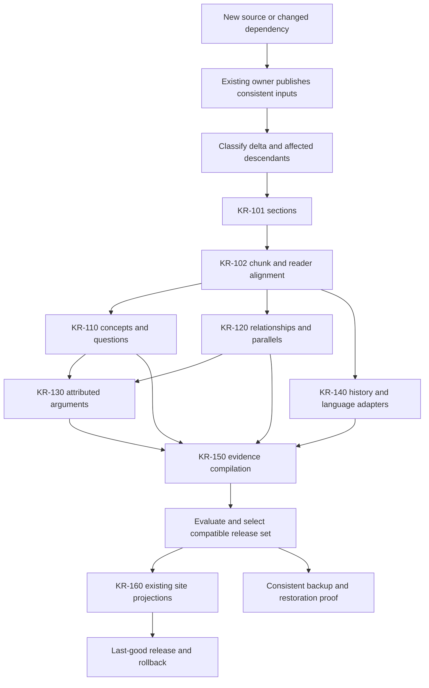

# Future additions, analytical refresh and recovery protocol

**Version 1 · 14 October 2026.** [Initiative](README.md) · [Single task ledger](TODO.md) · [Session handoff](HANDOFF.md) · [New-chat context](NEW-CHAT-CONTEXT.md).

The programs, SQLite facts, source proofs, job checkpoints and completed releases survive closing the conversation or rebooting the PC because they are saved in the project. Existing processors can resume their selected generations. A new acquisition is not automatically included in a historical release. Complete cross-generation refresh, all downstream processors and disaster recovery have not yet been implemented or verified. This protocol specifies how to build and operate that continuing system; it does not install a scheduler, backup or refresh service.

## 1. What is implemented and what is still required

| Capability | Current evidence | Remaining requirement |
| --- | --- | --- |
| Persist code and results | Existing Python/SQL, private databases, manifests and latest pointers | Source-control and backup protection; the initiative/analytics directories appeared untracked at this handoff |
| Atomic facts and checkpoints | `library_analytics/jobs.py` commits both together with FULL-synchronous SQLite WAL and per-job savepoints | Use this contract in every new processor; test each integration rather than assume it |
| Exclusive ownership and recovery | PID plus creation-token leases reject competing/inaccessible owners and recover abandoned jobs | Integrated owner checks for future refresh; never infer death from elapsed heartbeat alone |
| Same-generation resume | KR-101/102 reuse committed jobs; KR-110 and KR-120 also verified actual interruption/resume and completed-population idempotence; changed inputs are rejected/recorded | Cross-generation unchanged-fact reuse and changed/removed input planning are not proved across the whole system |
| Named releases and provenance | KR-101/102 and KR-110/120 candidate indexes have generation-bound tables, exported scope/dependencies, manifests and selected pointers | A compatible release set across all processors and consumers; KR-110 retrieval acceptance is unresolved |
| Selective invalidation | LK-107 proved source-specific invalidation for two bounded evidence collections | General section/concept/relation/argument/compiler invalidation and selective rebuilding |
| Concept/relationship/argument/history outputs | KR-110/120 CPU candidate indexes delivered; KR-130–150 remain planned | KR-110/120 have atomic jobs, dependency checks, tested same-generation resume/idempotence and immutable exports; KR-110 retrieval acceptance failed and KR-120 candidate quality/reference mapping remain limited; cross-generation selective refresh and backup restoration remain unproven |
| Serving without the PC | Existing website/static packs and bounded earlier products | KR-160 publishes evaluated new outputs through existing consumers |
| Backup and restore | No independent backup or restoration was verified in this task | Consistent off-device backup, dependency closure and a clean-location restore drill |
| Automatic restart | Existing Bible supervisor is deliberately disabled; latest AGENTS records separate bounded recovery and embedding-repair evidence, not reboot/logoff recovery | Separate owner authorization/verification; this protocol does not enable it |

**Resume, refresh, backup and restart are different operations.** A durable checkpoint permits resume; it does not automatically process newly added sources, protect against disk loss or restart a stopped process.

## 2. Saved assets and dependency closure

Keep the following together logically; private bodies and vectors do not belong in the public site or ordinary Git history:

| Asset | Existing location / owner | What must be retained |
| --- | --- | --- |
| Programs and contracts | `Website/knowledge/`, `Website/initiatives/library-knowledge/`, relevant existing source/build code | Code revision, dirty/untracked source snapshot, schemas, commands, rule/config versions and handoffs |
| Original holdings and provenance | Existing acquisition/library owners and manifest paths | Original bytes, SHA256/source ID, URL, title/roles, licence, format, audience/language, credit and warnings |
| Corpus and FTS5 | `KnowledgeBase/knowledge.sqlite3`, completion owner | Consistent database snapshot, build identity, import/source records and chunk-ID rules |
| Existing vectors | Existing vector store, embedding owner | Model/revision, dimensions and normalization, table/version identity, IDs, index/fragment manifests and all referenced data objects; never silently prune pinned objects |
| Metadata/text/product generations | `KnowledgeBase/library-analytics/` | Selected LA releases, source proofs, XML bridge/captured cache dependencies and job state |
| Sections | `KnowledgeBase/library-knowledge/connected-research/` | `sections.sqlite3`, releases, evaluation fixtures, scope/input proofs and latest-sections pointer |
| Alignment | `connected-research/alignment/` | `alignment.sqlite3`, releases, latest pointer, verification and selected corpus/reader proofs |
| Concept/relation/argument/history stores | KR-110 `connected-research/concepts/`, KR-120 `connected-research/relationships/`; future KR-130/140 owned paths under existing private root | Facts and jobs bound to parent versions, method/model/config identity, coverage and exclusions |
| Evidence packages and reviews | Existing `library-knowledge/` captures, crosswalks, eligibility and assembler outputs | Immutable evidence, attribution/qualifications, review fingerprints, recipes and reverse dependencies |
| Reader source/metadata | Existing catalogue and teacher-library files | Work/edition IDs, same-original-hash links, metadata shards, content-addressed page files and routing-code version |
| Public products | Existing site/build/release owners | Permitted projection files, release manifest, predecessor pointer and reproducible build inputs |
| Runtime receipts | Existing pipeline roots | Job/checkpoint stores, progress/logs, errors/deferrals, command, owner PID/creation identity and resource observations; secrets remain protected |

A JSONL export is not necessarily a full recoverable database. KR-102 exports do not replace the selected section store, all source bytes, job state or review records. Backups must close over the dependencies of the releases they claim to recover. Do not sum old generations as additional holdings or copy bodies into every derived store.

## 3. Trigger and record a change batch

Trigger a batch for newly held originals, revised extraction, corrected metadata/identity, documented moves/removals, reader publication/routing changes, vector coverage/model changes, analytical rules/code, review decisions or public-use policy changes.

1. Inspect existing acquisition manifests, source IDs, hashes and owner completion receipts. Skip unchanged originals from held indexes. Do not redownload or re-audit the whole library.
2. Record the selected parent release set, change-batch ID, input owner, proposed scope and resource budget. Current TODO/HANDOFF record who owns execution; retain old releases.
3. If intake/corpus work is necessary, hand it to the existing single completion owner. Preserve valid unchanged vectors. Analytical processing never starts a competing owner.
4. Select a coherent published source/corpus generation. CPU source processing may use captured immutable originals while embedding continues. Live corpus reads must be brief and generation-checked; a source swap stops the affected run rather than blending generations.
5. Compare identity plus evidence fingerprints, not filenames/titles alone. Classify new, unchanged, text-changed, metadata-only, moved, removed, rule/review-changed and unsupported inputs. Preserve edition distinctions and documented archive moves.

This batch description is executable input for a future refresh planner, not an approval queue or per-file essay. One machine-readable change list and one aggregate result are sufficient.

## 4. Dependency and reuse rules

Each processor needs a semantic fingerprint covering exactly the evidence it consumes: original/representation hash, structural key and section boundary version, selected metadata fields/roles, chunk IDs and body proof, applicable reader-page proof, rules/config/code/schema, review fingerprints and any model/vector coverage used. Keep provenance of parent runs separate from the narrow computation fingerprint so unrelated run timestamps do not force every document to recompute.

An unchanged fingerprint may reuse verified facts and proofs in a new generation, with explicit parent membership. Reuse must preserve original source coordinates and method/version identity. Never mark old data current by changing its run label. Same-generation successful job reuse alone does not establish cross-generation reuse.

| Change | Recompute / revalidate |
| --- | --- |
| New text | New document sections/alignment and applicable concepts; candidate relations to existing material; affected aggregates/retrieval ranks and products |
| Original/extraction change | New representation/section versions, affected chunk IDs, alignment, concept/relation/argument facts and dependent packages |
| Metadata/role correction | Only facts consuming those fields; attribution/author constraints, independence groups and consumer metadata as appropriate |
| Title/locator change | Check actual chunk-ID consequences: current chunk IDs include title, body and locator, so text equality alone cannot preserve IDs |
| Documented move | Rebind via verified manifest/hash; path-bound proofs may require a new generation even when bytes are unchanged; never edit historical proofs silently |
| Removal/ineligibility | Tombstone current membership; remove current recommendations/results, invalidate affected outputs, retain historical provenance where lawful |
| Reader page/routing change | Destination/page proofs and affected public projections; source text facts need not change if their dependencies are unchanged |
| New vector coverage | Rebuild affected semantic features/candidates and rankings; keep lexical facts if their fingerprints still match |
| Embedding model/revision/dimension change | A separate incompatible semantic generation; no mixing spaces or silently overwriting the old valid model store |
| Term/rule/model/prompt change | Facts using that version and their downstream products; record candidate/review status and evaluation implications |
| Review/rights/editorial change | Dependent interpretation or public projections; private inclusion remains separate from public eligibility |

**New sources can change old results.** Global document frequencies, work-diversity counts, rankings, co-citation weights and nearest-neighbor lists depend on the population. Recompute or revalidate those global features, or label an explicitly bounded approximation. New candidate quotations/neighbors can connect to previously processed sections. “Only process the new files” is insufficient for these outputs. Store aggregate/population dependencies and test a new source entering an old section's top results.

Review does not transfer automatically to a changed quotation, speaker attribution, section boundary or interpretation. Unchanged scoped review evidence may be retained only when its fingerprint still matches. A missing dependency makes current use stale/unresolved; do not invent a replacement by similar title.

## 5. Run the appropriate stages

Run only stages used by the declared capability; an unsupported language adapter does not block a separate lexical product. Every completed stage reports supported/eligible, unchanged/reused, new/changed/removed, deferred, failed, location precision and relevant quality measures. Retain source/edition/work units separately. Structural completion is distinct from evaluated interpretation and public delivery.

All new processors use the existing analytics JobStore and lease infrastructure with bounded atomic facts/checkpoints. One low-priority CPU worker is the default while embedding runs; measure CPU/RAM/disk before widening concurrency. Selective model work records cost and versions. No all-pairs millions-of-chunks comparison and no model-generation call for every chunk by default.

The current KR-101/102 commands operate on selected snapshots; they do not expose an implemented universal `--new-files` pipeline. New KR-101 inputs currently require an appropriately refreshed upstream LA selection. The future planner must resolve that owner dependency rather than feed a current corpus into an old historical scope.

## 6. Failure, resume and release rules

- Record command/cwd, owner PID plus creation identity, selected run, progress/error paths, completed/eligible counters and resume instructions.
- Verify process identity and exclusive ownership before recovery. Inaccessible ownership is a reason to stop that takeover, not proof the owner is dead. Preserve unrelated live jobs.
- Resume the same run only while its selected dependencies still match. Successful facts/checkpoints remain; uncommitted groups replay. Do not manufacture a new run to hide failures.
- Input/code/rule changes requiring different semantics create a new generation. Keep the old generation intact; reuse only fingerprint-equivalent facts through the implemented reuse contract.
- Failures/unsupported inputs remain structured dispositions with reasons. Acquisition failures remain the shared failed-download TODO; no endless retries. A corrective retry needs a documented changed condition or explicit later retry scope.
- Validate location integrity, identity and scope accounting, then capability-specific quality on reserved cases. Corpus/vector parity gates apply to claims using that whole selected semantic scope; graph publication uses its existing owner gates.
- Export to immutable generation directories with checksums, schema/method versions, dependencies, coverage, exclusions and evaluation receipts. Assemble a compatible manifest that pins every required upstream stage. Keep the old last-good pointer until the new capability passes.
- A mutable latest pointer is not a source snapshot. Consumers pin its resolved manifest/run. Promotion and rollback switch pointers through the existing atomic writer/owner; never overwrite historical evidence in place.
- Public projections must strip private paths/restricted bodies, preserve attribution/warnings and use honest held on-site reading destinations. Existing browser model packs require their own encoding and measured device costs.

## 7. Backup and restore: local persistence is not disk-loss protection

No backup destination or restore proof was established here. Choose an independently recoverable destination before claiming protection. A second folder on D: is a local copy, not protection against D: failure. Use the existing backup owner if one exists; avoid inventing a competing backup daemon.

1. Capture the selected release manifest and its full dependency inventory, code revision plus required uncommitted/untracked files, schema/config/environment versions and model identity. Keep private data out of public Git and exclude credentials from ordinary release manifests.
2. Snapshot SQLite with its online backup API or an owner-coordinated consistent checkpoint/snapshot. Do not copy just a live `.sqlite3` file while WAL may contain committed facts. Do not manipulate a live owner's WAL/checkpoint as a convenience. Record the build/run identifiers actually in each snapshot.
3. Pin a supported consistent vector-table version and copy its manifests plus every referenced object through the store's supported snapshot procedure. Concurrent writes/pruning require the vector owner's coordination. Do not claim a random live-directory copy represents a consistent table.
4. Copy originals, captured representations, reader packages, reviews, manifests and source dependencies of retained generations. Record hashes, byte counts and omissions. An omitted model cache may be recoverable from its recorded official revision, but do not call the backup fully offline-restorable without necessary local model files.
5. Preserve a last-good off-device backup before replacing it. Verify copied bytes and protect the backup from accidental overwrite. Retention/pruning must respect pinned analytical/vector dependencies.
6. Restore into a separate test root, using explicit root mapping without changing historical provenance. Open restored DBs, check integrity, resolve sample source/chunk/reader witnesses, verify vector identity/IDs and compare representative query/package results. Run an interrupted/resumed test only on this disposable restored state.
7. Record backup generation, destination, covered release set, bytes, checksum results, restore location/time, failures and recovery instructions. Only a passing restore drill establishes recoverability. Never test by deleting production originals or stopping the production embedding job.

## 8. Everything still needed in implementation

The [single TODO ledger](TODO.md) owns these requirements under KR-110–170 and LK-501–504; this list is the protocol contract, not a competing task-status ledger.

| Responsibility | Reuse / proposed implementation | Acceptance |
| --- | --- | --- |
| Source-change catalogue | Existing manifests/hash indexes and source owners; proposed refresh planner adapter | Classifies new/unchanged/changed/moved/removed/unsupported without full holding re-audit |
| Compatible run selection | Existing latest pointers and release manifests; proposed pinned refresh manifest | No mixed corpus/section/reader/model generations or unlabelled partial coverage |
| Dependency/reverse index | Extend current analytical proofs and assembler dependencies | Traces a changed input to exact affected facts/products, including population-wide dependencies |
| Cross-generation reuse | Extend existing facts/job membership without changing immutable versions | Unchanged supported facts reused; text/rule changes invalidate correct descendants; removed inputs disappear from current results |
| Stage coordination | Proposed `knowledge/library_analytics/refresh.py` responsibility, if existing owners lack it | Plan/status/run/resume semantics drive existing processors; one writer; no new intake/vector coordinator. These CLI commands do not exist yet |
| Remaining processors | KR-110 acceptance remediation; KR-120 quality/reference/semantic deferrals, KR-130 argument, KR-140 history/language and KR-150 compiler | Real populated tables, dependencies, focused quality evaluation and documented unsupported strata |
| Evaluation retention | Existing frozen questions/source windows and review fingerprints | Untouched reserved cases, explicit reviewer type, regressions measured; source changes invalidate affected judgments |
| Release selection and rollback | Existing atomic writers/manifests, extended to compatible stage set | Failed/stale candidate leaves last-good selected; consumers use pinned validated outputs |
| Existing-site updates | KR-160 page/build owners | Accurate held reading navigation, permitted fields, PC-independent products and measured device/query costs |
| Backup adapter and restore check | Existing backup owner if present; otherwise proposed owner-scoped Python snapshot/verification utilities | Consistent off-device dependency-closed backup and successful isolated restore |
| Recovery verification | KR-170 and separately owned native completion recovery | Unchanged rerun is no-op; interruption equals uninterrupted result; no duplicate writer or lost committed facts |
| Operational measurement | Extend existing receipts, not separate per-file paperwork | New/reused/changed/deferred counts, elapsed/CPU/RAM/disk costs, quality failures and delivered consumer benefit |

Develop reusable refresh/dependency/recovery mechanisms within each processor now. KR-170 verifies their integrated operation after the processors exist. Do not postpone basic repeatability until the final stage, and do not mark the entire framework complete because this protocol has been written.

## 9. Minimum proof before calling future additions routine

Use small disposable fixtures for operational failures and representative held strata for capability quality. One reusable suite must prove:

- Unchanged rerun causes no duplicate facts, review drift or output timestamp churn.
- Adding a source processes its eligible facts and updates affected old rankings/relationships/aggregate features.
- Changed bytes, boundary/rule, attribution, reader and public-use decisions invalidate the appropriate descendants while unrelated proven facts remain reusable.
- A documented move preserves source/edition identity with new binding proof; removal drops current membership while preserving the permitted historical record.
- A crash before atomic commit leaves neither partial facts nor success checkpoint; resume matches an uninterrupted run.
- Competing writer, unknown owner identity, source swap, incompatible model and stale reader location are rejected or explicitly deferred.
- Failed evaluation or incomplete export does not replace the last-good release; rollback restores the previous compatible consumer manifest.
- A separately restored backup can reconstruct witnesses and reproduce representative queries without production writers or missing undocumented dependencies.

Report the limits and measured costs of these checks. Do not claim exhaustive semantic correctness from checksums or sampled witnesses. Once this proof exists, each future acquisition batch follows sections 3–7 and leaves a short machine-readable run receipt plus aggregate handoff; no repeated campaign paperwork is needed.
