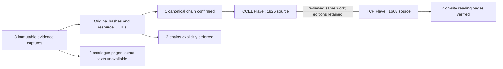

# Pilot identities and reader destinations — LK-104

**Completed 11 October 2026, evening EDT.** Reconciled the three LK-103 source documents and one explicitly selected alternative edition. Every selected source has a verified original-byte/resource binding and either an existing canonical chain or a documented deferral. No catalogue identities were invented, originals moved, or evidence captures rewritten.

## Result

| Selected source | Existing work / edition / asset chain | Print-source statement in held XML | Current on-site destination |
| --- | --- | --- | --- |
| Manton, Complete Works, vol. II | Deferred: all three canonical IDs absent from captured metadata and matched resource | London: James Nisbet & Co. (1871) | Verified catalogue page; text not offered |
| Flavel, Keeping the Heart / A Saint Indeed | Verified: `work-flavel-heart`, `edition-flavel-heart`, `asset-l11-flavel-heart-xml` | Joseph Martin, 1826 | Verified catalogue page; text not offered |
| Boyce, Abstract of Systematic Theology | Deferred: all three canonical IDs absent from captured metadata and matched resource | 1887 | Verified catalogue page; text not offered |

The dated print-source statements are separate from electronic creation dates: Manton 2009-01-25, Flavel 2011-04-28, Boyce 2012-05-04. Flavel's XML also records first publication in 1667 and editorial comparison with several versions. These are source-header assertions, with exact XML selectors, attributes and original hashes retained; they are not independent bibliographic certification. The original captures' unknown dates remain unchanged until an explicit future recapture incorporates these facts.

**3 selected source bindings resolved; 1 canonical chain resolved; 2 canonical chains deferred; 3 exact-edition public reading destinations deferred; 0 additional byte-identical resource copies found in the selected hash lookups.** The matched research-foundation resource UUIDs are reused. These numbers describe this small sample only.

## Duplicate handling and the readable alternative

The held TCP `A39682` text identifies a **1668** Flavel edition. Its existing work and edition IDs are retained, although the recorded `asset-bulk-tcp-a39682` has no canonical asset file. That candidate's asset registration remains deferred.

A bounded AI-assisted review relates this TCP edition to the underlying work represented by the CCEL Flavel edition. The crosswalk records the title, author and print-source evidence from both originals, preserves both work IDs and editions, and groups them for retrieval diversity. This is not a full collation, an exact quotation alignment, or permission to substitute the TCP text for a CCEL citation. Other adaptations, abridgments and acquired editions are outside this review.

The result has **4 source documents in 3 work-group buckets**, including **2 unresolved work identities kept separate**. These are retrieval buckets, not three independently certified works or independent witnesses. Identical bytes group file copies only; matching titles, URLs or source IDs do not merge works automatically.

## Outputs and checks

- Reusable [crosswalk module and CLI](../../knowledge/evidence_collections/crosswalk.py), documented in the [evidence tools README](../../knowledge/evidence_collections/README.md).
- Private specification, crosswalk and verification: `KnowledgeBase/library-knowledge/crosswalk-pilot-20261011/`.
- [Regression coverage](../../knowledge/tests/test_evidence_crosswalk.py): **46 tests passed** together with the existing evidence and research-foundation tests. Checks cover immutable database/capture bytes, reproducibility, changed dependencies, distinct work/edition identities, false catalogue matches, corrupt/missing bodies, date roles and non-invented passage links.
- Real preview verification at the existing **http://127.0.0.1:8931**: all four selected records matched the inspected package; three catalogue-only pages behaved as expected; all seven TCP reading pages matched the packaged body; no browser page errors. This is local-preview verification, not a production deployment check.
- Existing reader pagination has no passage deep-link support. The crosswalk records actual page/locator matches when available and never fabricates a `?page=` parameter or fragment.

The crosswalk is a private sidecar bound to the original collection fingerprints. Reverification checks selected originals, registry rows, canonical records, reader records/bundles, source-header review evidence and implementation. Unrelated registry changes do not require a whole-library rebuild. Neither the immutable source citations nor their publication decisions are changed.

## Remaining work

**LK-105 is now complete:** [public-use eligibility](PUBLIC-USE-ELIGIBILITY.md) records separate use decisions using this header/editorial evidence and current policy references. All three selected public text destinations remain deferred; private analytical inclusion continues. Manton and Boyce also need explicit canonical work/edition/asset registration before edition-dependent public citation export. The separate TCP candidate needs canonical asset registration; it is already readable in the existing preview. Next is LK-106 private retrieval.

Direct passage navigation, broader edition collation and later corpus recapture remain separate work. No intake, embedding, graph, public package or production configuration was changed. The private `pipeline-after.json` records the observed running workers and progress after verification.
