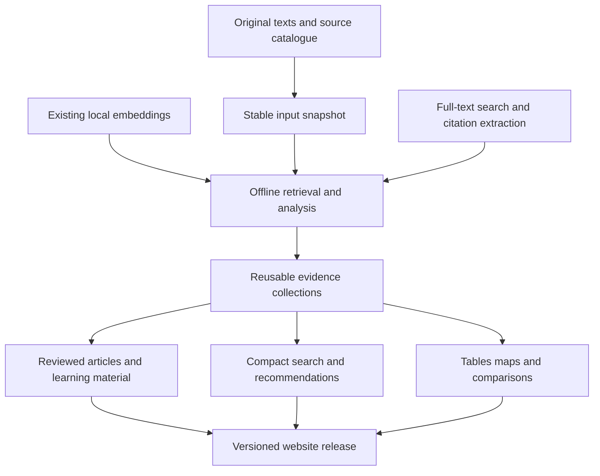
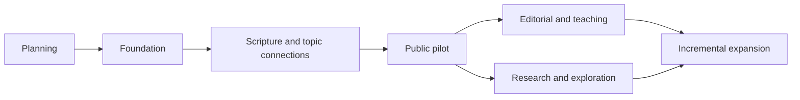

# Plan

[Initiative home](README.md) · [Execution backlog](TODO.md)

**Current implementation, 13 October 2026:** [DESIGN.md](DESIGN.md) defines the deeper procedural systems and [TODO.md](TODO.md) sequences KR-100/101 onward. The broad portfolio below remains the intended product range. Earlier bounded pilot completion is not proof that the six systems exist; read the [sufficiency review](REVIEW-2026-10-13.md).

## Outcome

Use the whole library to prepare knowledge once and reuse it across reading, research, teaching, discovery and editorial publishing. The production site must not depend on a service running on the owner's computer. Expensive local mining produces versioned artifacts that remain useful after the computer is switched off.

## Opportunity portfolio

| Avenue | Prepared output | Reader benefit | Lead |
| --- | --- | --- | --- |
| Bible reading companion | Passage-specific commentaries, sermons, context and questions | Study the passage with relevant held texts | W2 |
| Topics and doctrine | Hierarchical topics, definitions and narrower questions | Navigate a substantial subject library | W2 |
| Question library | Cited answers, qualifications and further reading | Immediate prepared responses | W3 |
| Comparative theology | Located positions, objections and replies | Understand real agreements and differences | W3 |
| Authors and scholars | Themes, major treatments, works and reading paths | Understand the contribution of each writer | W2 |
| Sermons | Passage/topic/application indexes and available timestamps | Reach the useful section of a sermon | W2 |
| Church history | Dated controversies, confessions, institutions and source dossiers | Trace developments with evidence | W5 |
| Archaeology and context | Place, period, artifact and inscription collections | Connect historical evidence with maps and texts | W5 |
| Original languages and fathers | Contextual terminology, justified alignments and translation comparisons | Read difficult multilingual material | W5 |
| Quotations and textual relationships | Verified quotations, parallels and attributed borrowing | Locate the source and understand the relationship | W5 |
| Teaching and learning | Courses, lesson sequences, discussion questions and revision cards | Progress from introduction to advanced reading | W3 |
| Practical Christian life | Edited collections on grief, prayer, family, work and perseverance | Enter through an everyday concern | W3 |
| Editorial production | Evidence packets for articles, explainers, newsletters and presentations | Sustain original source-grounded publishing | W3 |
| Discovery and personalization | Related readings, saved paths and optional subject packs | Find the next worthwhile text | W4 |
| Research tools | Citation networks, bibliographies and comparison workspaces | Investigate the collection directly | W5/W6 |
| Collection improvement | Duplicate, extraction, identity and coverage findings | Improve material and target future acquisition | W1/W7 |

These are opportunities, not promises that every source supports every feature. Scope language coverage, source types and uncertain data explicitly. New website sections should earn their place through useful content and connect to the existing Study hierarchy.

## The reusable unit

An evidence collection represents a question, topic, passage or historical problem. For example, an assurance collection can include Scripture, located treatments by several authors, definitions, objections, qualifications and applications. It can feed a topic page, Bible sidebar, comparison, lesson and sermon guide without repeating the research independently.

Preserve three layers: directly extracted observations, calculated associations, and editorial interpretation. Similarity finds candidates; it cannot establish truth, agreement, endorsement or historical influence.

## Delivery sequence

| Stage | Work | Exit condition |
| --- | --- | --- |
| D0 | Document programme and baseline | Linked plan, workstreams and actionable backlog exist |
| D1 | Establish foundation and representative evidence collections | Real source locations resolve; versions and publication rules are explicit |
| D2 | Connect Scripture, topics, authors and sermons | Useful sampled connections appear in existing page contexts |
| D3 | Deliver a bounded public pilot | Reviewed pilot content and browser discovery pass agreed quality and device checks |
| D4 | Expand editorial and teaching products | Shared evidence supports multiple useful formats without contradictory copies |
| D5 | Expand research and visual exploration | Historical and interpretive claims have suitable evidence and limitations |
| D6 | Repeat incrementally | Changed inputs regenerate dependent outputs, with quality and rollback recorded |

Search, evidence design and page specifications can be prepared while embedding continues. Heavy mining uses a consistent snapshot and resource budget. A full-corpus completion claim requires the existing coordinator's final intake and vector verification, including later acquisitions.

## Measure value

Measure accurate evidence links, useful distinct works surfaced, question success, task completion, reader usability and incremental build cost. Report sampled error rates and denominators. Record chunks, editions, works and contributors separately. More generated pages or graph edges is not by itself a gain.
