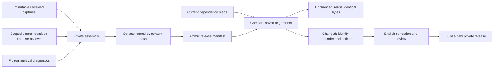

# Reproducible evidence collections — LK-107

**Completed 12 October 2026, EDT.** Two existing private evidence collections now have deterministic packages, explicit dependency hashes and selective invalidation. Unchanged builds reproduce identical bytes. A changed disposable Boyce original invalidated only the Boyce collection; the unrelated assurance collection stayed current. No intake, encoder, vector or public-site writes were performed.

## Delivered and verified

| Measure | Result |
| --- | ---: |
| Reproducible collections | 2 |
| Preserved reviewed passages | 3 |
| Historical retrieval questions linked | 4 |
| Unique dependency descriptors | 48 |
| Assurance / Boyce package dependencies | 37 / 27 |
| Existing upstream artifacts verified unchanged | 32 |
| Regression tests passed | 98 |
| Public outputs / encoder calls | 0 / 0 |

The assurance collection retains Manton and Flavel; the reported-position collection retains Boyce. Their original capture envelopes, exact quotations, neighboring context, source and edition identities, claim IDs, review fingerprints, qualifications and private publication state are copied unchanged. The previously reviewed crosswalk and source-use decisions remain separate, scoped sidecars. This packages existing reviewed evidence; it does not add new theological reviews or promote search candidates into approved claims.

Historical retrieval diagnostics link H01/H02 to assurance and H03/H20 to the reported position. They preserve both methods' ranked chunk IDs, recorded usefulness and whether selected evidence actually appeared. Boyce's retrieval misses remain visible. Search usefulness is not author endorsement or claim approval. The **17/20 retrieval result still fails the proposed 18/20 publication gate**.

## How refresh decisions work



Dependencies include held original bytes, selected live corpus rows and metadata, current immediate neighbors, relevant canonical records and resource registry rows, canonical proof files, source-specific crosswalk/use decisions, referenced policy evidence, collection recipe entries, capture files and implementation/schema files. Retrieval diagnostics bind to frozen snapshot/vector/query artifacts and the selected result and judgment records. Saved elapsed query timings are excluded from result dependencies.

Per-source and per-question projections keep unrelated valid updates from invalidating every collection in a shared JSON file. Shared policy evidence invalidates its dependents. A corpus-build change deliberately requires all these collections to be revalidated. Missing or unreadable dependencies fail closed with an explicit reason. Malformed or corrupt package files are reported as **invalid**, separately from intact packages whose dependencies are **stale**. A reverse dependency index maps each dependency to its collection IDs.

The build first verifies existing capture, crosswalk, use and retrieval bindings, then assembles all objects before exposing the manifest. JSON writes use the existing atomic writer. A current rerun writes nothing, including no timestamp churn. A stale release is retained intact; rebuilding it in place is refused. Corrections require explicit upstream recapture/reconciliation and a new private output directory. This is dependency tracking and reproducible assembly, not an automatic review system or the later production refresh service in LK-501.

## Acceptance evidence

- A second independent build produced identical object and manifest hashes; a repeated build reused every file without changing bytes or modification times.
- All three capture records and their review fingerprints exactly match the earlier LK-103 artifacts. No missing identity or reader destination was invented.
- The real source-change experiment redirected only the Boyce original-byte dependency to a disposable, initially identical copy. Changing that copy made **1 collection stale / 1 current**. Restoring it returned both to current. Held originals and corpus rows were never modified.
- Disposable fixture tests cover changed or missing originals/chunks, changed metadata, modified and newly inserted adjacent context, scoped crosswalk/use/recipe changes, shared policy and build changes, corrupt outputs, changes during assembly, partial-build failure, public-output refusal, reverse dependencies and byte reproducibility.
- The original 78 checks plus 20 assembly checks all passed: **98 total**. Original LK-106 rankings, labels, vectors and benchmark remain unchanged.

## Outputs and commands

Implementation: [assemble.py](../../knowledge/evidence_collections/assemble.py), [tests](../../knowledge/tests/test_evidence_assembly.py), [tool instructions](../../knowledge/evidence_collections/README.md).

Private output root: `KnowledgeBase/library-knowledge/assembly-pilot-20261012/`.

| Path beneath that root | Purpose |
| --- | --- |
| `recipe.json` | Explicit collection inputs and diagnostic question selections |
| `release-final/manifest.json` | Authoritative private release and reverse dependency index |
| `release-final/objects/*.json` | Two immutable evidence packages |
| `verification.json` | Both packages current at completion |
| `acceptance.json` | Counts, reproducibility checks and preserved-input results |
| `source-change-verification.json` | Measured selective invalidation on the disposable copy |
| `pipeline-before.json`, `pipeline-after.json` | Dated observations of the preserved running pipeline |
| `upstream-before.json` | Hashes of the 32 prior artifacts checked unchanged |

`reproducibility-copy/` and `source-change-fixture/` are private acceptance fixtures, not additional reviewed collections. The earlier `release/` directory is a development build that predates the final implementation; use **`release-final/`**. Existing generations are deliberately retained.

```powershell
# From Website; an unchanged build is a no-op.
..\KnowledgeBase\.venv\Scripts\python.exe -m knowledge.evidence_collections.assemble build --recipe ..\KnowledgeBase\library-knowledge\assembly-pilot-20261012\recipe.json --folder ..\KnowledgeBase\library-knowledge\assembly-pilot-20261012\release-final
..\KnowledgeBase\.venv\Scripts\python.exe -m knowledge.evidence_collections.assemble check --folder ..\KnowledgeBase\library-knowledge\assembly-pilot-20261012\release-final
```

`check` prints a machine-readable report and exits nonzero for stale/invalid output. It never edits stored review states or original artifacts. Reports are observations; run the check again before consumption. Recorded reader and public-use decisions remain dated and require their upstream workflows to be reverified before publication. Local hashes cannot certify changes to remote source policies.

At **01:53 EDT on 12 October**, the original embedding worker, loaded encoder, intake owner and graph monitor were all verified alive. Embedding had reached **7,442,597 / 8,458,873**, and advanced during assembly. Intake remained `waiting_for_current_embeddings`; the graph monitor remained `waiting_for_verified_intake`. These dated observations do not assert final corpus or graph completion.

## Remaining work

LK-107's acceptance is complete. The foundation tasks LK-101–107 are complete for this bounded pilot, not the full collection. **Next is LK-201:** perform a cheap coverage check and select a Bible book for the first connected-library pilot; Romans remains a candidate until checked.

Before publication, address the three retrieval misses and assess improvements on fresh reserved questions. Carry forward two missing selected canonical chains, three unavailable exact-edition readers and the TCP alternative's missing asset registration. Corpus intake, final embedding parity and graph completion remain under their existing coordinator. No public export, deployment, new model or competing pipeline was started.
