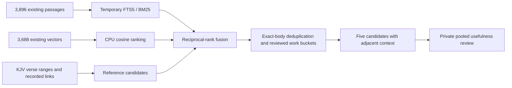

# Bounded retrieval comparison — LK-106

**Completed 11 October 2026, evening EDT.** Implemented and measured a private retrieval pilot. Hybrid retrieval found a useful top-five result for **17/20 questions**, versus **12/20 for keyword-only retrieval**. The proposed **18/20 release gate is not met**. This completes LK-106's implementation/comparison acceptance, not the later publication quality gate.

## Measured result

| Measure | Keyword-only | Hybrid |
| --- | ---: | ---: |
| Questions with a useful top-five result | 12/20 | 17/20 |
| Useful-result rate | 60% | 85% |
| Mean reciprocal rank, top five | 0.450 | 0.825 |
| Median query time after loading | 3.25 ms | 6.35 ms |

The improvement is **25 percentage points**, or five additional successful questions, within this fixed sample. Timings exclude initial source/vector loading, query encoding and review. They are not whole-library search latency or a browser-performance claim.

Questions and rubrics were recorded before retrieval. Four separate development questions were used for functional/performance checks, then the implementation and inputs were frozen before the 20 held-out searches. These are a small English set chosen around the existing pilot, including familiar assurance/attribution examples. They are not an independent human benchmark, and the proposed 80-question development set remains future work.

Usefulness was assessed by an **AI-assisted review** of a pooled set of both methods' top-five passages. The pool hid method names, rank and scores and retained locators and immediate context. Individual positive/negative labels and reasons are saved. Useful means relevant support for the recorded question, not a complete approved answer or proof that a theological proposition is true. No exhaustive recall or precision claim is made.

## Scope and implementation

| Input | Observed scope |
| --- | ---: |
| Named documents | 11 |
| Existing corpus passages | 3,896 |
| Existing vectors copied for CPU search | 3,688 |
| Selected passages without vectors | 208 |
| Existing document-level Scripture links in scope | 1 |
| Frozen query embeddings | 24 |

The scope includes the three CCEL pilot editions, TCP Flavel `A39682`, KJV Romans/Ephesians/Proverbs/Psalms/1 John/John, and existing `harmony:2`. All 208 missing vectors belong to the TCP edition. It remains keyword-searchable; no new document embeddings were created. The four theological documents have **zero existing `references_to` records**. This is a coverage gap, not evidence that the texts contain no Scripture references.

The source snapshot comes from a read-only SQLite transaction. Existing LanceDB vectors were read through a pinned table version and copied into a private bounded CPU matrix; the version and model identity are recorded in `snapshot.json`. Pinning affects this reader handle, not other workers. [LanceDB Python versioning documentation](https://lancedb.github.io/lancedb/python/python/).

The existing encoder served 24 short query embeddings in serialized batches of four. No new encoder, index-building process, vector model, graph writer or competing intake pipeline was started.

Keyword retrieval uses the existing normalized `search_text` and title fields in a temporary **in-memory FTS5** index, with OR query tokens and BM25 title/text weights of 3/1. Initial attempts against the live global FTS index were too slow even with document-first query planning; only those pilot development-query processes were stopped. The memory index changes no persistent corpus data. Both methods use the same lexical channel, scope, duplicate policy and context expansion.

Hybrid retrieval adds exact cosine ranking over available selected vectors and recorded-reference candidates, fused with reciprocal rank (`k=60`, up to 40 candidates per channel). Exact normalized body duplicates collapse; at most two passages per reviewed work bucket survive. Existing edition IDs and source locations remain intact. Unknown work identities remain separate; related editions are not counted as independent witnesses. Each result includes at most one preceding and one following passage from the same document.

Bible passage ranges, verse annotations and document-level associations remain distinguishable. The harmony link does not certify a particular chunk as an exposition. A post-evaluation annotation correction relabeled verse footnotes; **every selected chunk, score and ranking was verified unchanged** against the preserved initial run. No held-out ranking weights were tuned.

## Misses and remaining quality work

Hybrid misses **H03 and H20**: the specific Roman position reported by Boyce and Boyce's objection/endorsement stance. General justification passages and author front matter are insufficient. The correct passage exists in the earlier evidence pilot, so these are retrieval failures, not missing-source findings.

Hybrid also misses **H06**, Flavel's counsel on prosperity. Introductory metadata and another author's relevant discussion do not answer an author-specific question. Keyword-only retrieval additionally misses H02, H09, H15, H17 and H18.

Before publication, improve author constraints and distinguish primary body text from modern introductions, indexes, footnotes and colophons. Test those improvements on **new reserved questions**, keeping this benchmark as a diagnostic set. Do not repeatedly tune against these 20 questions and continue calling them held out. Full-library, multilingual and independent human evaluation remain pending.

## Outputs and verification

- [retrieve.py](../../knowledge/evidence_collections/retrieve.py): bounded snapshot, query preparation and private retrieval CLI.
- [evaluate.py](../../knowledge/evidence_collections/evaluate.py): deterministic metrics from explicit recorded judgments; no automatic label generation.
- [Retrieval tests](../../knowledge/tests/test_evidence_retrieval.py) and [evaluation tests](../../knowledge/tests/test_evidence_evaluation.py), alongside existing evidence checks: **78 tests passed**.
- Private artifacts under `KnowledgeBase/library-knowledge/retrieval-pilot-20261011/`: `questions.frozen.json`, `snapshot.json`, `snapshot-manifest.json`, `selected-vectors.npz`, `query-vectors.json`, `evaluation-freeze.json`, development/held-out results, `review-pool.json`, `judgments.json`, `evaluation.json`, `acceptance.json` and `pipeline-after.json`. The evaluated implementation and pre-annotation results are retained there too.

Tests cover model mismatch, changed snapshots/builds, invalid vectors, partial vector coverage, distinct work/edition handling, source context boundaries, reference-vs-annotation distinctions, private outputs and scoring. The real run verifies source-text/locator/context correspondence, frozen questions, reproducible result ordering and unchanged rankings after the annotation correction. No private result was exported or deployed. Supplemental Bible/study inputs have not been promoted to public eligibility by this retrieval step.

Final acceptance verified all **3,896 snapshot passages** against the live read-only corpus, **198 returned candidates** and **382 neighboring contexts**. All **40 method/query replays** reproduced the complete saved results except elapsed timings. Recorded judgments reproduced the metrics exactly; frozen inputs and both implementation versions passed their hash checks.

At approximately **23:48 EDT on 11 October**, the original embedding worker, loaded encoder, intake owner and graph monitor were all verified alive. Embedding had advanced to **7,342,821 / 8,458,873** passages. Intake continued waiting for current embeddings; the graph monitor continued waiting for verified intake. Their processes, configuration and vectors were preserved. This observation is a dated progress check, not a claim of final corpus completion.

**Next is LK-107:** reproducible evidence collections and dependency invalidation, using these bounded candidates. The failed release gate and LK-105 identity/reader/public-use deferrals remain open requirements before publication.
