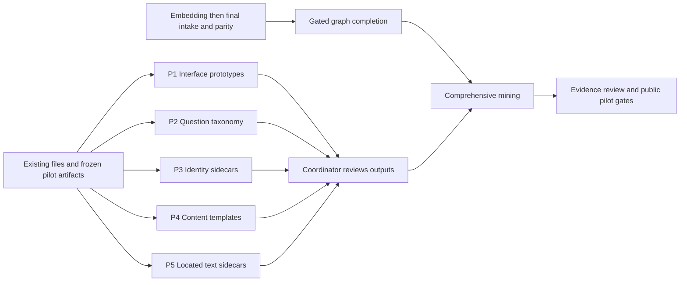

# Five independent preparation tracks

**P5 / Library Atlas addendum added:** the [shared correction](SESSION-CORRECTION-HANDOFF.md#p5--library-atlas-conversation-addendum) now also records this programme's misdirection, P5's actual twelve-record output, subsequent dependency changes and the corrected database/CPU-analytics objective. Earlier proposals below are historical and must not override that correction.

**Owner correction — read first:** [Data-first direction and cross-conversation handoff](SESSION-CORRECTION-HANDOFF.md). The owner rejected the UI/planning emphasis and requested CPU data engineering, analytics and reusable database tables. Do not automatically execute the earlier five-track programme as though that correction had not occurred. The handoff distinguishes completed P3 implementation from analytics that was announced but never built.

**12 October 2026 · proposals ready for execution.** This package authorizes useful preparation during embedding; it does not declare final intake, vector parity, graph processing or comprehensive mining complete.

| Track | Concrete result | Owned proposal and output folder |
| --- | --- | --- |
| P1 · Interface designs | Three interactive study-interface prototypes with realistic availability states | [01-interfaces](01-interfaces/PROPOSAL.md) |
| P2 · Question taxonomy | 25 scoped topic proposals and 100 unanswered reader questions, split into development and reserved evaluation sets | [02-question-taxonomy](02-question-taxonomy/PROPOSAL.md) |
| P3 · Source identities | Four-source Ephesians identity/edition/reader crosswalk with exact evidence and unresolved counts | [03-source-identities](03-source-identities/PROPOSAL.md) |
| P4 · Presentation templates | Five reusable content templates and a visual specimen gallery | [04-presentation-templates](04-presentation-templates/PROPOSAL.md) |
| P5 · Bounded source locations | Selected Hodge and Calvin sermon passages located in existing texts, with literal reference evidence | [05-source-locations](05-source-locations/PROPOSAL.md) |

All five can start now and finish independently. P1 designs the surrounding interface; P4 designs the content blocks inside it. P3 investigates identity and editions; P5 investigates exact text locations. P2 defines the questions without retrieving or answering them. Each uses existing inputs rather than waiting for another track's deliverable.

## Shared execution contract

Read the repository's applicable AGENTS.md, this file and the assigned PROPOSAL.md. Paths below are relative to `D:\FortressOfSolitude\Jarvis\Projects\BibleProject`.

- **Write ownership:** each conversation owns only its numbered folder under `Website/initiatives/library-knowledge/parallel-preparation/`, and its matching numbered folder under `KnowledgeBase/library-knowledge/parallel-preparation/`. It may create helpers and isolated fixtures inside those folders. No other conversation writes there. Keep private text, detailed identities, internal paths and runtime data in KnowledgeBase.
- **Shared files are read-only:** production source, routes, styles, catalogues, original assets, manifests, existing evidence captures, schemas, shared tools, central READMEs/TODO/HANDOFF, wiki and other tracks. Do not change branches in the shared checkout. If shared integration is needed, describe it in your handoff; do not implement it. No commit, deployment or public export.
- **Pipeline protection:** no intake, embedding, graph extraction, encoder, model download, corpus rebuild, acquisition or watchdog commands. No vector queries. Preserve all original text and existing vectors. No `evidenceOnly` holds. Do not update completion/status files.
- **Resource use:** at most one modest CPU worker per track. P1/P2/P4 need no corpus connection. P3/P5 may read only selected document records in short read-only SQLite transactions. Avoid transactions held across review or rendering. Never run whole-library scans, full database hashes, archive extraction or large in-memory copies. Read source hashes for selected files only. If an input changes or cannot be read safely, record the affected work as pending; do not repair the live pipeline.
- **Input consistency:** record selected source hashes, corpus build if consulted, and the specific existing artifact fingerprints used. Check selected inputs before finalizing. Changed inputs make affected output provisional/stale, never silently current. Do not alter immutable pilot packages or refresh their review seals.
- **Presentation:** use current project typography and theme tokens. P1/P4 produce self-contained HTML artifacts in their own folders, with synthetic display text clearly labelled. Inspect with file-based browser screenshots or standalone rendering. Do not introduce another server or rebuild shared `dist/`. User-facing Bible preview remains 8931; adding a preview route there is a later coordinator action. Never import private source bodies into a mockup.
- **Evidence:** preserve work/edition differences, translator/editor roles, source gaps and conflicts. A located passage is not doctrinal approval. External URLs supply provenance, never a substitute reading action. Unknown identities, dates, reader destinations and public permissions stay unknown.
- **Completion:** deliver useful artifacts, not another planning essay. Maintain one `RESULT.md` in the owned proposal folder: changed paths, input scope/version, completed and unresolved counts, verification, limitations, and exact proposed integration changes. Add `handoff.json` with `track`, `status`, `outputs`, `inputVersions`, `completedCounts`, `unresolvedCounts`, `verification`, `integrationNeeds`, and `requiresFinalSnapshotRecheck`. Use `complete`, `partial` or `blocked` for this bounded task only. No repeated per-file check suites.

## Recombination

After the five conversations finish, the coordinator reads their five RESULT.md/handoff.json outputs, resolves proposed contract differences, inspects designs, and approves any shared integration as a separate task. P1 and P4 are visually reconciled once; P2's identifiers are mapped to the accepted catalogue; P3 and P5 sidecars are joined by existing document IDs without rewriting originals. Reserved evaluation questions stay separate from tuning. After final intake/parity/graph gates, revalidate corpus-dependent sidecars before using them in comprehensive mining. Design acceptance and evidence readiness remain separate.

Copy/paste conversation starters: [PARALLEL-PROMPTS.txt](PARALLEL-PROMPTS.txt).
