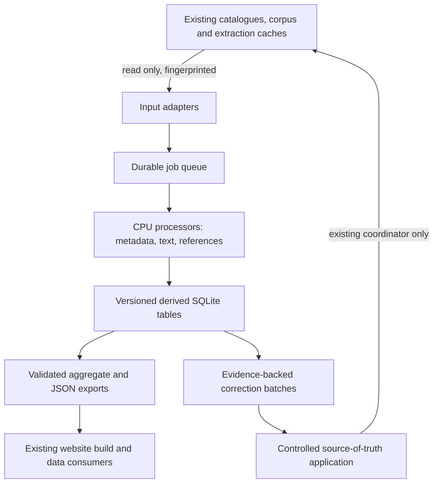

# Library Data Pipeline: implementation plan

**13 October 2026. Status: LA-01, LA-02 and LA-03 complete and independently verified; LA-04 source application delivered, with corpus incorporation, remaining reconciliation and consumer delivery pending.** See [LA-01 results](REFINEMENT-RESULT.md), [LA-02 results](TEXT-RESULT.md), [text-analysis contracts](TEXT-ANALYSIS.md), [LA-03 results](PRODUCTS-RESULT.md), [product contracts](PRODUCTS.md) and [LA-04 application results](APPLICATION-RESULT.md). The selected bundle accounts for 214,449 corpus documents across eleven kinds; identified coverage gaps remain explicit. The module table below describes the full target architecture; coordination and export are combined in the existing runner modules.

Extend the working `knowledge/library_analytics` package into a local, resumable Python/SQLite processing system. Turn held material into reconciled identities, measured text quality, explicit citations, document structure and reusable analytical tables. Feed the existing website through its established catalogue and build contracts. Routine processing runs without GPT calls or a live vector-search service.

## Starting point and intended delta

The [completed warehouse](RESULT.md) contains 868,686 overlapping input observations, 26 tables, two views and 13 exports in a private 1.39 GB SQLite database. It counts 8,458,873 chunks through existing indexes; it has not analysed all their text. These are dated snapshot counts, not a final library total.

| Existing evidence | Implementation outcome |
| --- | --- |
| 12,091 field-level identity backfill candidates | Current-source validation, accepted/rejected patch batches and measured application results |
| 6 unresolved contributor IDs affecting 159 memberships | Evidence-backed resolution or explicit unresolved reasons; no invented identities |
| Raw language/source labels | Versioned normalization with raw assertions retained |
| 9,662 declared readable records without a same-hash corpus text match | Reconciliation through alternate representations, canonical IDs and documented archive moves; distinct unresolved states |
| Aggregate chunk counts | Per-document quality, structure and literal reference measurements |
| Recorded-hash overlap | Separate byte duplicates, likely textual reuse and genuinely distinct editions |
| One completed warehouse generation | Incremental jobs, crash recovery, versioned releases and stable consumer exports |

The current builder has bounded reads, validation and a build lock, but **does not resume interrupted stages**. Resumability is new implementation work.

## Architecture



Code belongs in `Website/knowledge/library_analytics/`. Runtime jobs, databases and private exports belong in `KnowledgeBase/library-analytics/`. Originals, vectors and the graph remain owned by their existing pipelines. Avoid a second corpus containing millions of copied chunk bodies: stream text from current read-only inputs or existing extraction caches and store derived facts plus locators.

## Programs to build

These are modules in one package, not separate services. Keep small functions together where that reduces complexity.

| Python module | Responsibility | Durable results |
| --- | --- | --- |
| `__main__.py`, `jobs.py` | One CLI, job scheduling, leases, checkpoints, cancellation and status | `jobs`, `job_attempts`, `checkpoints`, `run_metrics` |
| `inputs.py` | Adapt current warehouse, canonical metadata, corpus and extraction caches; record dependency fingerprints | `input_versions`, `job_dependencies`, reconciliation evidence |
| `normalize.py` | Explicit source, language and genre mappings; nested metadata recovery before inference | `normalized_metadata`, `normalization_issues` |
| `identities.py` | Validate work/edition pairs, contributor roles, alternate representations and archive moves | `identity_links`, `identity_evidence`, `correction_candidates` |
| `quality.py`, `structure.py` | Stream text once where practical; measure quality and retain structural boundaries from TEI/ThML and existing text locators | `document_quality`, `document_sections`, `text_processing_gaps` |
| `references.py` | Extract explicit Bible references with exact offsets and boundary evidence | `literal_references`, `reference_rejections`, `reference_coverage` |
| `duplicates.py` | Separate recorded-byte duplicates, normalized-text candidates and edition relationships | `text_fingerprints`, `reuse_candidates`, `edition_candidates` |
| `aggregate.py` | Build Scripture/source/author/language matrices and descriptive profiles | `passage_coverage`, `author_profiles`, `source_contribution`, `analysis_coverage` |
| `apply.py` | Produce dry-run patches, verify current values, apply authorized source metadata changes and record rollback information | `patch_batches`, `patch_items`, `application_receipts` |
| `export.py` | Validate versioned consumer contracts and publish an atomic private release pointer | `release_manifest.json`, selected JSON/JSONL and SQL views |

Retain `build.py` as the baseline snapshot builder; factor out reusable adapters rather than rewriting it wholesale. Extend meaningful tests around new behavior instead of generating per-file check suites.

## Delivery order

### LA-01: durable jobs and actual metadata refinement

Deliver a working runner together with the first useful transformations, rather than building infrastructure in isolation.

1. Add a small control database and migrations. Make input discovery and completed-item results restartable.
2. Normalize equivalent language assertions such as `en`, `eng`, `English` and `EN`. Preserve Middle English separately. Retain raw values, rule version and evidence. Unknown remains unknown.
3. Recover missing metadata from existing structured headers and canonical records before considering language detection or model inference.
4. Revalidate all 12,091 existing backfill candidates against current canonical work/edition files and source values. A same recorded hash is useful evidence, not permission to overwrite an existing conflicting value.
5. Investigate the six missing contributor identities using existing source records; keep person, editor, translator and assembly roles distinct.
6. Reconcile reader/corpus gaps with documented archive moves and edition/asset relationships. Distinguish absent hash, moved original, alternate representation, intake pending and unresolved identity. Do not trigger blanket downloads or re-embedding.

**Acceptance:** every existing candidate receives a reproducible disposition; normalization totals reconcile; crash/resume and repeated-run tests prove no duplicate results; a dry-run patch batch identifies exactly which source fields would change. Report accepted, rejected, stale and unresolved counts. Canonical metadata application belongs to LA-04.

### LA-02: broad CPU text analysis

Process all eligible library-text documents in the selected snapshot, then other document types through explicit adapters. The inspected snapshot contains 39,167 `library_text` documents; count again at execution. This is the initial processing population, not all acquired holdings.

- Measure text length, replacement-character rate, unusual control characters, repeated line/block rates, heading density and available language evidence. Store metric values and flag reasons; a flag is not proof of bad OCR.
- Recover structural sections from existing markup and locators. Preserve the distinction between printed page labels, reader pages and chunk offsets. Do not invent page numbers for plain text.
- Reuse the pure `CitationParser` and boundary handling in `knowledge/enrichment/citations.py`. Do not invoke the graph-writing enrichment runner.
- Store exact source spans, parser version, book/chapter/verse bounds and rejection reasons. Cross-chunk matches retain both source spans. Explicit citations do not establish agreement, doctrine, quotation authorship or exhaustive thematic coverage.
- Distinguish literal address matches from their roles before consumer rankings: SWORD module entry headings, printed Scripture indexes, prose citations and cross-reference lists are different evidence. The LA-02 sample review exposed this requirement; canonical bounds and valid offsets alone do not resolve it.
- English and early-English rules do not imply Latin/Greek coverage. Record supported and unsupported language/numbering cases separately, then add tested language-specific rules.

The existing main-corpus reference table contains no recorded references for those library-text documents. Other graph/enrichment stores may already contain useful extraction: inspect and reuse compatible outputs before duplicating work.

**Acceptance:** every eligible input is completed, failed or explicitly deferred; offsets resolve against the exact analysed text; boundary, numeral and multilingual fixtures pass; representative source/language samples receive precision review. Publish measured coverage and errors, not an unsupported whole-library claim.

### LA-03: analytical products for existing pages

Build these from normalized identities, located text and extracted references:

| Product | Useful question it answers | Important limit |
| --- | --- | --- |
| Scripture coverage matrix | Which held authors and works explicitly discuss or cite each passage? | Citation counts and exposition must be labelled separately |
| Contributor profiles | Which works, languages, periods and cited passages are represented for each contributor? | Unknown dates/roles remain unknown; prolific authors must not dominate every ranking |
| Source contribution tables | Which collections add distinct works, editions, languages or passage coverage? | Byte uniqueness is separate from work uniqueness |
| Edition and reuse candidates | Which texts are alternate editions, overlapping transcriptions or reused passages? | Bible quotations and boilerplate are filtered or separately labelled; no automatic deletion |
| Descriptive vocabulary profiles | Which terms are unusually common for a work, author or collection? | Compare within compatible languages/genres; frequencies do not prove theological positions |
| Coverage and quality tables | Where do missing metadata, poor extraction or unsupported scripts limit conclusions? | Every denominator identifies its snapshot and processing population |

Use incremental fingerprints and candidate generation for textual reuse; never compare every pair of chunks. Benchmark a bounded sample to choose fingerprints and thresholds, then process the full eligible population. Evaluate optional dependencies only when measured performance requires them. SQLite and Python remain the starting architecture.

**Acceptance:** aggregates reconcile to underlying evidence, sample results trace to on-site text where available, and repeated runs with unchanged inputs produce equivalent outputs. Exports are useful inputs to the existing Teachers, reader and study pages; this stage does not create replacement UI.

### LA-04: controlled application and consumer delivery

**Delivered source application:** 3,751 reader edition IDs and six contributor entries are applied in both metadata projections; 8,338 corpus fields are registered in original-hash-bound source fills. A repeated full run writes zero changes. [Receipts and limits](APPLICATION-RESULT.md), [owner integration and rollback](APPLICATION.md). Live corpus metadata is unchanged; remaining incorporation/reconciliation and UI delivery are not marked complete.

- Reuse `scripts/teacher_identity_overrides.py` and its hash-bound override contract where applicable. Its current identity validation expects a valid work/edition pair: do not blindly submit isolated field proposals.
- Write durable source-of-truth metadata, not disposable generated files alone. Record expected old values, new values, evidence, source fingerprints and reversible before-images.
- Apply only validated rule classes within the authorized scope. Missing values may be filled when evidence is sufficient; conflicting identities remain unresolved. Never infer publication permission from possession or identity matching.
- Route corpus changes through the existing intake coordinator. No direct updates to the live corpus database or vectors while embedding runs. Check existing content/metadata invalidation behavior before promising that a metadata refresh requires no re-embedding.
- Refresh the existing catalogue and consumer exports through their owners. Keep private paths and restricted text out of public artifacts; retain source credits and provenance.

**Acceptance:** application receipts show actual changed records, skips and failures; rerunning makes no additional changes; rollback is exercised on fixtures; existing reader/catalogue contracts pass. Public deployment remains a separate requested action.

## How procedural operation works

**Incremental identity.** A job key includes task, input ID, input content/metadata fingerprint, processor version and configuration version. Dependency changes invalidate only affected derived results. Do not use timestamps alone as content identity. A source that changes during a batch is marked stale and rediscovered.

**Durable execution.** Persist pending/running/succeeded/failed/deferred/stale states. Claim work atomically with a lease, heartbeat and process identity including start time. Commit output rows and completion checkpoints in the same transaction. A restarted coordinator recovers abandoned leases only after checking ownership; it never launches a second owner for live work. `succeeded` jobs with matching dependencies are skipped.

**Bounded failure.** Data errors retain their source and reason and do not block unrelated jobs. Use bounded retries only for transient local failures; permanent extraction errors go to a failures export. Downloads retain the owner's no-retry rule. A failed job cannot silently become a successful release.

**Resource control.** Begin with one below-normal-priority CPU worker, bounded text batches and bounded SQLite cache. Measure memory, disk activity, throughput and embedding progress before increasing concurrency. Pause new analytical batches when resources constrain the embedding pipeline; do not restart or reconfigure that pipeline. Never load millions of bodies into RAM.

**Honest releases.** Maintain separate job status and release status. Promote a release atomically only after schema, integrity, count, dependency and coverage checks. A deliberately partial release lists all failed/deferred populations. Keep the previous validated release available. Completion means completion of a named snapshot and scope, not that no future intake can arrive.

**Evidence fields.** Derived rows retain input identity/hash, run, processor/config versions, raw assertion where relevant, derivation method, supporting location and disposition. Use explicit evidence categories rather than fabricated numerical confidence scores. Keep accepted canonical identities separate from possible matches.

**Scheduling.** First prove manual interruption and recovery. Then add one scheduled coordinator with a single-instance lock and bounded restart policy if unattended operation is requested. A scheduler is recovery support, not a guarantee against power loss, disk failure or corrupt inputs.

## Intended operator interface

`run`, `status`, `validate`, `prepare-patches` and `export` are implemented for LA-01. LA-04 source application uses the separate module CLI below. Run from `Website/`:

```powershell
python -B -m knowledge.library_analytics run --profile cpu --resume
python -B -m knowledge.library_analytics status
python -B -m knowledge.library_analytics validate --run <run-id>
python -B -m knowledge.library_analytics prepare-patches --run <run-id>
python -B -m knowledge.library_analytics.apply --prepare
python -B -m knowledge.library_analytics.apply --apply
python -B -m knowledge.library_analytics.apply --verify <application-folder>
python -B -m knowledge.library_analytics export --run <run-id>
```

The baseline snapshot builder remains `D:\Python\python.exe -B knowledge/library_analytics/build.py`. Its build lock remains separate from the new refinement coordinator and does not make interrupted baseline builds resumable.

## Evaluation and useful reporting

Report processed/eligible documents, changed/unchanged inputs, accepted/applied metadata corrections, unresolved identities, citations with valid locations, coverage by language/source, failure counts, elapsed CPU/wall time and release path. Keep observations, works, editions, documents, chunks and embeddings as separate units.

Test destructive or ambiguous boundaries: crash after output before checkpoint, duplicate workers, stale source hashes, conflicting IDs, mixed contributor roles, repeated Bible quotations and citations split across chunks. Use a small representative throughput calibration to estimate full-run hours; do not substitute the sample for the requested bulk run. No reliable runtime estimate exists until the text processors are benchmarked.

Metadata refinement, quality/structure analysis, literal references and descriptive aggregates can run on versioned snapshots while embedding continues. Final vector-wide clustering, semantic coverage claims and whole-library graph publication must wait for their relevant completion checks. Do not impose that dependency on independent CPU analysis.

## GPT level and division of labour

**Recommended default: GPT-6.1 Sol with High reasoning for implementation.** Use GPT-6 Astra with High or Extra high reasoning for difficult architecture decisions, identity-conflict policies and independent review of mutation/recovery logic when the additional cost is justified. Medium is sufficient for routine adapters and straightforward test fixes. This is an engineering recommendation, not a claim that one setting wins every task.

Official guidance positions Sol for complex projects with cost considerations and Astra for the most demanding work, and explains the speed/thoroughness tradeoff of reasoning effort: [model selection](https://developers.openai.com/api/docs/guides/model-selection), [reasoning guidance](https://developers.openai.com/api/docs/guides/reasoning).

GPT designs, writes and reviews the programs. Python/SQL execute bulk processing locally. Do not send every chunk to a model. If later ambiguity genuinely requires model classification, first establish an evaluated task, bounded budget, explicit data scope and a reviewable output contract; model suggestions remain separate from canonical facts.

**Current execution:** LA-03's verified products are retained as dated snapshots. LA-04 has applied accepted reader metadata and registered corpus fills through existing source owners. Next work reconciles the 9,652 held-original gaps plus ten CSEL cases and incorporates corpus metadata through its owner before refreshing current consumer snapshots. Existing language/citation gaps remain explicit. The established UI consumes eligible analytical outputs after these checks; no additional UI proposal track is needed.
